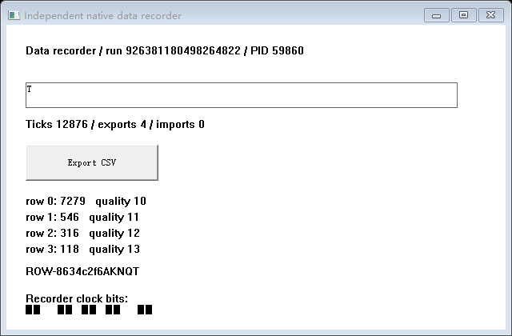
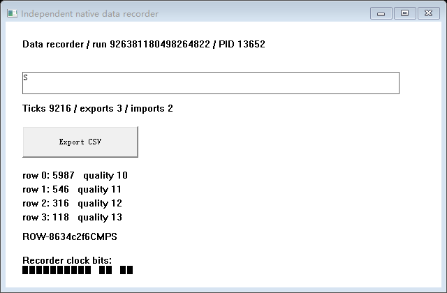

# FV-03/FV-04：恢复分支持续交互与预览独立性

2026-10-29，Windows 11 x64 10.0.26200，普通用户。实现提交 cc4f2a2af；起点 34c9bf9。MSVC 19.44.35229.0、Windows SDK 10.0.18362.0，C++20。没有重启宿主、关闭 CET/CFG/GS、引入新输入 API、增加资源支持或改变历史门禁。

**自动部分受限通过；人工宿主隔离仍未验证。** 最终 b4 构建完成六个场景、814 项检查，另完成一次长时入口、786 项检查和 R1 九个正反用例。检查数包含证据、生命周期和故障正确检测，不是能力数量。没有重新执行整个 R5→R4 旧嵌套组合；该组合仍以 6415104 对应的历史通过记录为基线。

## 实际运行

| 场景 | 结果 |
| --- | --- |
| fixture ABI v1 三帧的恢复 View 持续交互 | 通过；10 轮交错输入、状态/隔离核对和新帧 |
| recorder ABI v2 四帧的恢复 View 持续交互 | 通过；相同内核与 manager，10 轮 |
| 两款应用默认恢复流程 | 分别通过；没有进入持续阶段 |
| fixture 的 RB 输入桥真实退出 | 操作失败保持失败；首错 owned_input_bridge.exit / 109；未重建输入桥。RA 随后真实处理字符，C 继续计算和绘图 |
| recorder 管理器在 live-ready 被监督器强杀 | 预期故障正确检测；Job 内进程、句柄与 Desktop 独立清理确认 |
| 最终 fixture 长时入口 | 自动部分通过；共 48 轮。专用宿主窗口运行约 61 秒，未收到人类确认，人工项 not_executed |

来源：[自动汇总](automatic-summary.json)、[长时入口汇总](manual-entry-summary.json)、[独立监督结果](supervisor-results.json)、[R1](r1-summary.json)。前六项使用 C:/fv-c/live/full2，第七项使用 human2，均使用同一 b4 二进制包。长时模式的 60 秒是循环时段，当前有界操作完成后关闭窗口，不是硬实时期限。

14 次管理器运行的独立监督协议及物理清理均通过；汇总包含 350 个被监督登记的进程实例和 42 个 Desktop。实例按 PID＋原生创建时间区分，不能将这些数字解释为唯一 PID 数。故障操作没有被后续清理成功改成成功。

## 恢复与持续操作的证据

保持原来的真实链路：保存磁盘 S0/SA/SB、源与原 A/B 退出、旧管理器退出；新管理器加载固定磁盘状态，恢复 RA/RB，从原 S0 恢复 C。既有原始内存/栈/R10、目标自己的 CET CALL/RET、七个 HWND 重关联、原生 Undo、私有文件和 Artifact 处理均由原断言及只读原始字节 oracle 核对。不是新建冷启动演示窗口。

只有三者已发布且前序恢复核验没有失败，才进入新阶段。每轮真正投递已有受管键盘输入，原生 EDIT 完成选择和替换，原窗口字符处理更新受管内存；交错点击真实 BUTTON，由应用调用已有 Win32 文件路径。操作前后核对另两个 View 的文本、选择、焦点、Undo、非时钟业务状态和 HWND 不变，允许自主计数继续增加。三者均有实际计算推进和新 GDI Frame，不能仅用“进程存在”判活。

这里实时编辑产生了多操作 Undo；本轮不再保存这些现场，也没有扩大 Undo Snapshot 支持。S0/SA/SB 和固定 Artifact 的磁盘清单在操作后保持不变。

## 预览不拥有执行生命周期

单独的 auxiliary.exe 是 Win32/GDI 只读预览，用 WIC 解码真实采集 PNG。它不持有应用进程控制句柄，不提交业务输入；Frame feed 以 FILE_MAP_READ 映射，并实际核对 PAGE_READONLY。另一个控制 mapping 仅传递预览选择、关闭和显示回执。

每款应用均实际经历：无预览操作 → 查看 RA/RB/C → 正常关闭预览 → 持续操作 → 新预览被明确强杀 → 持续操作 → 第三次打开并选择 View → 全部预览退出后仍执行。没有重建 View 或重试 Snapshot。

Frame 附带 View、PID＋创建时间、TID、逐 View 序号、采集区间、真实绘制计数和 SHA256。采集计数直接来自既有目标 GUI 线程采集回执；逐帧 oracle 对照 PNG 的计数像素与目标绘制日志。预览的确认来自实际 WM_PAINT，检查显示的序号/哈希与对应生产帧一致、时序未过期；重开首帧采集发生在前一个预览正常关闭之后。

预览窗口用 WS_EX_NOACTIVATE、SW_SHOWNOACTIVATE，不调用 SwitchDesktop、SendInput、SetCursorPos、SetForegroundWindow 或 AttachThreadInput。代码在帧/生产者时序过期时清除旧图；本次显式故障是预览进程退出，没有另行宣称完成所有图像损坏/生产者卡死组合的验收。

原生依据：[MapViewOfFile](https://learn.microsoft.com/en-us/windows/win32/api/memoryapi/nf-memoryapi-mapviewoffile)、[Extended Window Styles](https://learn.microsoft.com/en-us/windows/win32/winmsg/extended-window-styles)、[ShowWindow](https://learn.microsoft.com/en-us/windows/win32/api/winuser/nf-winuser-showwindow)。这些接口语义不替代本次实测。

最终 recorder 的真实 Frame：

## 宿主人工项仍未执行

最终专用宿主窗口只记录本窗口的事件计数、挑战是否匹配及人类明确确认，不保存输入正文。实际没有字符/点击或确认；观察到鼠标移动消息也不能推断已完成真人验收，见 [原始窗口事件](host-events.jsonl)。

管理器另按操作边界记录前台 HWND、物理光标、输入 Desktop 和最后输入时间，不记录其他窗口标题或输入内容。两款自动场景以及长时入口均有外部输入区间；长时入口 96 个样本中还记录一处没有新 lastInput 的状态变化、80 个外部输入区间，变化来源未确认。结论为 inconclusive，不是“宿主未被抢占”通过证明。见 [fixture](fixture-host.json)、[recorder](recorder-host.json)、[长时](manual-host.json)。

因此本轮只为 FV-03 的恢复分支独立交互和 FV-04 的预览生命周期子集增加证据。用户一边在宿主打字/点击、一边操作恢复分支的完整验收仍需要真人执行 README 的 manual 入口。没有用自动输入、计时结束或专用窗口存在来代替。

## 构建身份、失败与回归

恢复 kernel、manager、两款应用、输入组件和清理组件按字节复用已有通过包，只编译新实验客户端和辅助窗口。20 个实际 EXE/DLL/OBJ/LIB 文件在两次最终入口前后核对 SHA256；225 个记录的原生源码输入与实现提交对应的工作副本逐项匹配。[构建](build.json)、[源核对](source-audit.json)、[入口身份](test-identity.json) 保留原值。

原生编译完成后，仅将离线审计改成缓存已退出写入者的不可变 JSON 行，并补入口身份记录；编译时 test.ps1 哈希和实际运行脚本哈希分别保留，没有把缓存结果当作断言结果。最终测试没有覆盖或重编译依赖。默认恢复回归实际运行了两款应用；共享底层 native/common 工具未修改，R1 九个用例也实际重跑。没有把以前的全嵌套回归记作本轮执行。

开发记录完整保留：

- b1 的构建记录曾因 PowerShell 大小写不敏感变量相撞而失败；首个运行误用限制 4 KiB 的 Artifact 哈希读取 PNG，明确失败，监督清理通过。没有放宽 Artifact 的限制，改用已有通用字节哈希。
- b2 的真实持续运行、预览与清理完成，但 Frame 描述误读另一份 telemetry 的零计数，30 项来源检查失败。未删除断言，改为返回原采集回执。
- b3 的六场景矩阵通过；收尾检查发现输入退出被测试专用末尾错误覆盖，b4 改为传播真实首错，并实测其他 View 故障后仍工作。
- 早先 human1 的原生长时阶段与独立清理完成，但低效的只读审计被明确中止，记录 [审计中止](earlier-manual-audit-interrupted.json)，不当作整套入口通过。最终 human2 用完成日志缓存完整跑完；没有用后续绿色结果覆盖早期材料。

原始开发材料与候选二进制在 development 归档。最终原始日志、磁盘 Snapshot/Artifact、工作文件、输入回执、Frame、执行/栈/CET/资源证据、完整 b4 运行包及原生源码在 verified 归档；每个归档都独立重读逐成员核对 SHA256，清单列出全部文件。见 [development 清单](development-manifest.json) 与 [verified 清单](verified-manifest.json)。

下载：[最终证据与运行包](verified.tar.xz)、[开发阶段原始材料](development.tar.xz)。两包分别为 19,113,984 字节/2,816 个成员和 8,737,624 字节/3,220 个成员。最终包含 b4 目录，可作为构建脚本的 Source，或直接使用其 manager/controller、应用与新客户端运行本实验；工具链路径见 build.json。重新运行必须用新的输出/证据目录；这是新操作，不会改写归档结果。

不宣称通用 Windows 应用、稳定 SDK、GPU、多线程、更多 Undo、宿主重启或断电恢复。历史文本服务等待、钩子 /126、创建 /5 的因果问题保持未解决：cleanupCausalFixVerified=false、fullR5004Passed=false、gateClosed=false。
