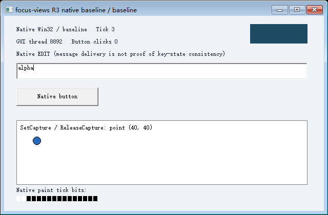
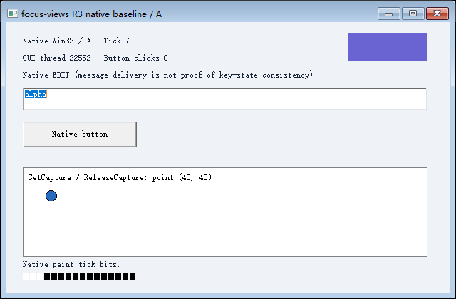

# R3-002 实际实验报告

2026-10-24，Windows 原生用户态实验，对应 CAP-12。**代码已编写、已编译、已运行；受管队列键态与原生 EDIT 修饰键行为的指定子集通过。R3 整体未通过，GUI 保存/恢复没有开展。**

## 环境与代码身份

- Windows 11 家庭版中文版，10.0.26200，x64，Intel i9-13900HX，普通用户权限。
- MSVC 工具目录 14.44.35207，编译器 19.44.35229.0；Windows SDK 10.0.18362.0。
- C++20，`/W4 /WX /O2 /MT`，链接 `/DYNAMICBASE /NXCOMPAT /CETCOMPAT`。没有驱动、虚拟机、第三方运行库或系统安全设置修改。
- 开发基线 `9703ae98f4f692ed22f3bfa545774e4c78147f96`；本轮源码与二进制哈希见 [identity.json](verified-full/identity.json)，工具链见 [build.json](verified-full/build.json)、[实际构建输出](build-final.log)、[系统](system.json) 与 [导入依赖](dependencies.txt)。不能仅用基线提交代表带新增文件的构建，复核应使用记录的源码哈希。
- 对照和介入组均使用同一个 `r302.exe` 的 fixture 角色。`../r3/fixture.cpp`、`bridge.cpp`、`protocol.hpp` 原样编译，未替换查询接口、控件过程或消息循环。R1/R2/common 和 R3-001 源码/历史结果未改。

## 可复现命令

在仓库根目录运行；本机工具链参数如下，标准安装可省略路径参数：

```powershell
.\experiments\r3-002\build.ps1 `
  -MsvcRoot 'D:\focus-distinct-browser\.tools\msvc\VC\Tools\MSVC\14.44.35207' `
  -SdkRoot 'D:\Windows Kits\10' -SdkVersion 10.0.18362.0
.\experiments\r3-002\test.ps1 -Scenario modifier -ResultsDir '<新的最小实验结果目录>'
.\experiments\r3-002\test.ps1 -ResultsDir '<新的完整实验结果目录>'
```

最终同构建最小实验记录在 [verified-modifier](verified-modifier/summary.json)，随后完整实验记录在 [verified-full](verified-full/summary.json)。另有 [1 秒自动保持模式冒烟](hold-smoke/summary.json)。**最终交付源码的结论以这些运行的身份清单为准**，不混用旧二进制的结果；开发中间日志保存在本地忽略目录 `out/development-runs`。`modifier-checks.log`、`full-checks.log` 和 `hold-checks.log` 是最终脚本的输出。

## 执行边界与机制

三个冷启动真实 Win32 实例：baseline PID/TID `37668/8892`，A `26432/22552`，B `13120/32668`；三个独立后台 Desktop，无预览、不切换输入桌面。这里 A/B 只是输入诊断实例，不是从 S0 恢复的 GUI 分支。

每个实例有独立常驻输入桥、共享消息批次、序号和 DLL 数据。桥先核对编辑框与顶层窗口的 PID/TID、桌面，再调用 `SetWindowsHookExW(WH_GETMESSAGE, ..., targetTid)`。只有明确标识的受管消息被展开；DLL 在目标 GUI 线程、实际 `PM_REMOVE` 时调用 `SetKeyboardState`，处理当前 down/up，保留左右键与通用键的关系。随后仍由应用原来的循环和原生 EDIT 处理。所有原版 `GetKeyState/GetKeyboardState/GetAsyncKeyState` 调用保留。

同一批次的包在完成前不可改写；发送端不写整串输入的最终键态。DLL 的只读诊断探针在目标线程对下一条封装消息执行两次 `PeekMessage(PM_NOREMOVE)`，验证查看不消耗、不重复推进状态。该探针属于运行时诊断，不是对 fixture 的改造；未据此证明任意应用自己的过滤/模态循环都受支持。

事件分三层核对：输入接受、钩子出队、原生控件处理。批次末尾的屏障只有在前面的键消息分派返回后才能出队；桥随后请求只读观测。普通字符还核对 `TranslateMessage` 派生消息的实际控件结果，不假定所有派生字符都排在屏障前。脚本把钩子记录与 fixture 的 `control_before/control_after` 按顺序独立匹配。

## 真实结果

最终完整实验的 **32 项控制器断言、39 项独立证据检查符合预期**。这些数量不是输入能力数量。能力状态仍保留 5 个实际失败，以及异步键态不支持、人工未执行；本轮静止宿主采样通过仅限观测时段。

| 场景 | 原始观测与判定 |
| --- | --- |
| 关闭状态写入的 Ctrl 对照 | Ctrl 消息到达；原版 `GetKeyState=0`、键盘表 Ctrl=`0`，两个按下高位均未置位，能力 **fail** |
| 完全无钩子对照 | 正常释放、解除钩子、常驻桥退出后，用旧助手直接 PostMessage Ctrl，仍是消息到达、高位未置位，能力 **fail** |
| A 的受管 Ctrl-down | `GetKeyState=-128`（SHORT 的 `0xFF80`）、键盘表 Ctrl=`128`（`0x80`），两个按下高位为 1；**通过**。低位不作为本轮按下判据 |
| A 持 Ctrl、B 工作 | B 的两个 Ctrl 高位保持 0；B 的 Home/End 导航和 X down/up 真正执行，原来的 TranslateMessage 产生字符，EDIT 从 `alpha` 变成 `alphax`；A 的 Ctrl 仍按下；**通过** |
| 左右 Ctrl、Shift | 右侧已按下时释放左侧，通用键仍按下；两侧全部释放后通用/左右高位清除；**通过** |
| 连续入队 down/up | 同批四次 Ctrl down/up 各消费一次，每次目标查询对应当前事件；未提前应用未来 up；**通过** |
| 重复查看消息 | `removed=0` 的重复查看没有应用状态，后续每个序号仅一次 `removed=1`；**通过** |
| 故意漏掉一次状态写入 | Ctrl 消息收到但原生查询未按下；能力仍是 **fail**，反例被检测的断言才是通过 |
| 原生 EDIT Shift+End | 相同输入对照停在 `5..5`，能力 **fail**；介入后的 A 选区 `0..5`，B 选区 `0..6`（其文本多了真实键入的 x），**通过**；未用 EM_SETSEL 或文本设置命令 |
| 正常取消/卸载 | A 持 Ctrl 后取消，原生键态清除，下一批仍能处理；B 在 Ctrl 和 Shift 均真实按下时正常关闭，确认通用/左右高位清除、解除钩子、桥退出，health=`0`；**通过** |
| 无法确认释放 | 有意暂停本实验 A 的 GUI 线程；释放包 `61`、屏障 `62` 已接受，但只消费到 `60`。`target_dequeue_ack` 超时错误 `1460`，health=`-1`，桥退出码 2。**释放确认能力 fail**，不能报告健康卸载；恢复线程后 B 仍独立处理新输入，最后只清理本实验资源 |

原始证据：[输入桥 A](verified-full/run/A-input.jsonl)、[输入桥 B](verified-full/run/B-input.jsonl)、[对照桥](verified-full/run/baseline-input.jsonl)、[A 原生控件与查询](verified-full/run/A-events.jsonl)、[B 原生控件与查询](verified-full/run/B-events.jsonl)、[控制器](verified-full/run/controller.jsonl)。所有 `queryThread` 均核对为对应 GUI TID。

三个 PNG 都来自未修改截图助手的真实 PrintWindow/GDI 路径，独立解码像素 Tick 并匹配采集调用期间目标的绘制日志：对照 Tick 3、A Tick 7、B Tick 8。文件哈希在 [images.json](verified-full/images.json)。

| 无状态介入，选区 5..5 | 有状态介入，选区 0..5 |
| --- | --- |
|  |  |

## 宿主、清理与未改变的结论

最终完整运行有 69 次宿主采样、0 个外部输入间隔、0 次前台/输入桌面/光标/Ctrl/Shift 高位变化、0 个采样错误，静止观测状态为 **pass**，仅覆盖这段静止采样，不代表人在持续操作宿主时已通过。开发时存在外部输入的运行仍判为 inconclusive，没有把外部活动当作串扰或改写为支持。原始数据见 [host.jsonl](verified-full/run/host.jsonl)。目标的原版 `GetAsyncKeyState` 在 Ctrl 按下场景仍返回 0；该能力没有被修复或替换。

完整运行创建的 10 个子进程均确认退出，三个 Desktop 均释放，没有 cleanup_error；故意失效的 A 输入桥退出码 2 是预期错误，不是成功清理的伪装。测试结束时 fixture 由控制器结束，未让其接管宿主输入。没有调用 SendInput、SwitchDesktop、SetCursorPos、SetForegroundWindow、AttachThreadInput；SetKeyboardState 只存在于 runtime DLL 中。

人工宿主交互 **未执行**。`-HoldSeconds 1` 只证明保持入口和目标输入继续运行，结果仍 `not_verified`；[运行说明](../../README.md) 给出 30 秒人工流程，不能自动认证人是否实际操作。R3-001 的“采集取消后再次取图未确认”和“人工未执行”保持原结论；本轮只复用了正常截图助手，没有重做采集取消实验。

R1/R2 与公共工具未改，因此本轮**未重跑 R1/R2**，也未声称旧实验被重新复验。旧 R3-001 源码禁止项与历史证据保持原样，脚本核对相关路径相对 `9703ae9` 没有差异。

## 结论范围

已验证：在本机、当前二进制、受管消息入口和单 GUI 线程普通循环下，目标线程真实队列键态与 Ctrl/Shift/Home/End/X 消息、原生 EDIT 行为一致；A/B 对应表与控件相互独立，错误和未确认释放有明确失效行为。

保存、恢复、运行态分叉：**本轮均未验证 GUI 范围**。没有将新窗口称为恢复，也没有用 GDI 成功推导 GPU 支持。多 GUI 线程、应用模态/过滤循环、IME、死键、布局切换、Alt/系统组合、自动重复时序、Raw Input、后台异步键态、完整焦点/鼠标路由、任意第三方应用仍未覆盖。入口虽然允许 A–Z，本次只有 X 有实际字符证据。

下一项机制实验应单独针对后台异步键态的运行时语义；完整鼠标路由是另一条研究路径。当前证据不要求驱动，也不能据此推断一种 Hook 足以兼容所有应用。

接口依据：[SetKeyboardState 的线程作用域](https://learn.microsoft.com/en-us/windows/win32/api/winuser/nf-winuser-setkeyboardstate)、[WH_GETMESSAGE 的 REMOVE/NOREMOVE 语义](https://learn.microsoft.com/en-us/windows/win32/winmsg/getmsgproc)、[线程钩子和 DLL](https://learn.microsoft.com/en-us/windows/win32/api/winuser/nf-winuser-setwindowshookexw)、[GetAsyncKeyState](https://learn.microsoft.com/en-us/windows/win32/api/winuser/nf-winuser-getasynckeystate)。这些是实验的机制依据，实际通过条件仍来自上述原始观测。
