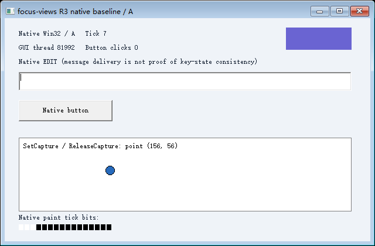
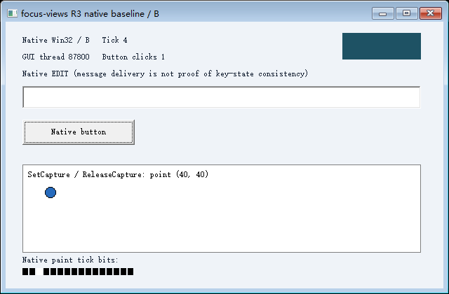

# R3-004 实测报告（2026-10-24）

已编写、已用 MSVC 编译、已在本机 Windows 运行；本次受限鼠标实验符合声明范围内的验收。R3 整体、GUI 快照恢复与 R4 仍未完成。宿主人工交互未执行，完整运行中的宿主采样结论为 **inconclusive**，不宣称已证明人工操作无干扰。

## 构建与复现身份

基线 `791a547bbada6e7342fa98816a197cfe566e9ce3`；Windows 11 x64，系统报告 `10.0.26200.0`，非管理员；MSVC `19.44.35229.0`，Windows SDK `10.0.18362.0`，C++20、静态 CRT `/MT`，`/W4 /WX /O2 /DYNAMICBASE /NXCOMPAT /CETCOMPAT`。未安装驱动、第三方运行库或虚拟机，未改变系统保护。

[完整身份清单](full-verified/identity.json) 包含源码、EXE 和 DLL 的 SHA-256；[构建信息](full-verified/build.json) 记录实际工具路径。源码哈希对应运行时工作区字节（包含行尾），构建脚本与测试脚本见 [实验目录](../../README.md)。原版 `experiments/r3/fixture.cpp`、`bridge.cpp`、`protocol.hpp` 与既有实验源码未修改。observer.cpp 是同一 EXE 内的只读查询扩展，无业务状态赋值。

顺序为先运行最小命中/捕获链路，再运行完整 A/B 场景及负向测试。最终记录：

| 执行 | 控制器断言 | 独立证据检查 | 结果 |
| --- | ---: | ---: | --- |
| [最小实验](minimal-verified/summary.json) | 37 | 31 | 符合预期 |
| [完整 R3-004](full-verified/summary.json) | 70 | 72 | 符合预期 |
| [R3-003 完整回归](full-verified/r303-regression/summary.json) | 44 | 62 | 符合预期 |
| [其中 R3-002 完整回归](full-verified/r303-regression/r302-regression/summary.json) | 32 | 39 | 符合预期 |

数字是断言/证据检查数，不是已支持的输入能力数。原生失败、故障注入和未执行的人工测试保留各自状态。R1/R2 未修改，也未在本轮重跑。

## 实际链路

[完整原始控制器日志](full-verified/run/controller.jsonl)、[控制台输出](full-verified/console.log)、[A 输入与路由](full-verified/run/A-input.jsonl)、[A 原版 GUI 事件](full-verified/run/A-events.jsonl)、[B 输入与路由](full-verified/run/B-input.jsonl)、[B 原版 GUI 事件](full-verified/run/B-events.jsonl)。

| 观测点 | 实际证据 |
| --- | --- |
| 原生 API 对照 | 相同二进制、相同受管路由与队列表机制，但关闭 IAT 替换；左键异步查询仍为 0，GetCursorPos 返回 FALSE / 错误 5。动态 USER32 查询同样未被拦截。这不是“关闭全部运行时”的新基线，原 R3-001 基线保持原样 |
| A 左键已接受、未出队 | sequence=5、version=4、consumed=4；异步高位为 1；队列表高位为 0、capture=0；GetCursorPos 得到屏幕 (128,301) |
| A 处理 down 后 | 真实 GetCapture=3154658，即 A 的 drag HWND；GetKeyState / GetKeyboardState 左键高位均为 1 |
| A 越界移动 | 输入 top-client (650,350)，运行时读取真实捕获后路由到 drag-client (626,146)，窗口真实消息处理更新 dragX/Y；逻辑点已越过拖拽区域和顶层客户区 |
| 同时 B 点击 | B 的原生 BUTTON 发出 BN_CLICKED，buttonClicks=1；B 光标 (128,229)，左键高位松开、capture=0 |
| B 点击后 A | capture=3154658、focus=1778466、光标 (698,421)、drag=(626,146)、左键高位仍按下，均保持 A 自己的值 |
| A 松开后 | 原版拖拽窗口调用 ReleaseCapture；真实队列与虚拟异步高位清除；再点 (80,158) 命中 BUTTON，A buttonClicks=1 |
| 连续 down/up | 接受时异步状态已松开，随后原版 drag_down 仍观察到队列高位按下；重复 PM_NOREMOVE 未更新队列表或消费序号 |
| 原生 EDIT 回归 | 路由点击建立原生焦点，字符消息后 Home / Shift+End 得到真实选区 0..5，没有设置文本或选区的业务命令 |

GetCapture/GetFocus/GetKeyState/GetKeyboardState 保持原生查询；GetAsyncKeyState 高位与 GetCursorPos 是明确的主 EXE IAT 虚拟化结果。两槽的原入口、替换入口、模块、保护和恢复均记录并由控制器读取目标进程内存核对；真实 EXE 调用指令为指向对应 IAT 槽的 RIP 相对间接调用。

无捕获时运行时在自己的窗口树命中；有捕获时由运行时补上越界定向路由。没有调用全局鼠标输入、移动物理光标或切换输入桌面。窗口和控件确实属于 Windows，并不表示 Windows 自动提供了两个物理鼠标。

## 真实图像

5 次新的 PrintWindow 均增加目标绘制次数，PNG 中 Tick 位由独立 PowerShell 像素解码并与调用时间内的原生绘制日志匹配。A 圆点位置另做像素核验；控制器未拼接或生成业务画面。没有预览进程。

| 图像 | Tick | 原生绘制次数前→后 |
| --- | ---: | --- |
| [A 越界仍持键](full-verified/run/A-outside-held.png) | 5 | 6→7 |
| [B 已点击](full-verified/run/B-clicked.png) | 4 | 5→6 |
| [A 回到可见区域仍持键](full-verified/run/A-inside-held.png) | 7 | 9→10 |
| [A 终态](full-verified/run/A-final.png) | 8 | 12→13 |
| [B 终态](full-verified/run/B-final.png) | 7 | 9→10 |

## 失败与清理

| 用例 | 实际结果与日志 |
| --- | --- |
| 外部 View 的窗口候选 | [wrong-owner](full-verified/run/wrong-owner-input.jsonl)：mouse.route.ownership / 5，消息未派发给 B，当前通道失效；B 仍可点击 |
| 捕获窗口销毁 | [destroyed-capture](full-verified/run/destroyed-capture-input.jsonl)：真实 DestroyWindow 后，上一条原生处理后已观察的捕获窗口不再有效；captured_window.destroyed / 1400，拒绝继续命中其他控件 |
| 漏发 button-up | [omitted-up](full-verified/run/omitted-up-input.jsonl)：测试租约 200ms，mouse.button_up.lease_expired / 1460；清除异步状态、队列表和捕获并恢复 IAT；仍是失败通道 |
| 持键正常关闭 | [close-held](full-verified/run/close-held-input.jsonl)：释放确认后两个导入及页权限恢复、自持引用释放、桥正常退出 |
| 输入桥意外退出 | [控制器 watchdog 证据](full-verified/run/controller.jsonl)：确认桥进程终止后，GUI 线程定时器令通道失效 / 109，清除左键和捕获并恢复两个 IAT；异常回调保留 DLL 自持引用直到测试 GUI 退出。桥被终止，故不伪造桥端退出日志 |
| GUI 线程挂起 | [hung-thread](full-verified/run/hung-thread-input.jsonl)：target_dequeue_ack / 1460，随后 invalid_channel_cleanup_unconfirmed / 1460，保留原始错误与 DLL 引用；不会报告健康卸载。平衡本实验的挂起后仅终止自己拥有的进程 |
| IAT 恢复拒绝 | [uninstall-refusal](full-verified/run/uninstall-refusal-input.jsonl)：injected.IAT.restore_refused / 5，左键/捕获已清理，但两个入口仍指向有自持引用的运行时；通道失效 |
| 两槽安装中断 | [partial-install](full-verified/run/partial-install-input.jsonl)：第一个真实槽交换后注入 ERROR_CANCELLED / 1223，回滚并核对两个原始入口和权限，不发布 ready 通道 |

每次失败后都有独立 B 的按钮继续操作证据。完整运行创建的 27 个子进程全部确认退出，11 个后台 Desktop 全部 CloseDesktop；无生命周期清理错误。负向断言通过仅说明拒绝被正确检测，日志里的能力失败没有改成成功。

## 宿主观测与未覆盖范围

[宿主原始采样](full-verified/run/host.jsonl) 共 120 次：externalInputIntervals=50、quietChanges=1、errors=0。该轮存在真实宿主输入；还有一处状态变化未与同一采样区间的 LastInputInfo 更新对齐，无法仅凭 50ms 样本归因，因此完整运行的静止宿主结论保留 **inconclusive**，没有筛掉样本或重跑以获取绿色结论。源码审查未发现禁止的宿主输入调用。30 秒人工交互流程尚未执行，不能据此宣称“用户正常操作已人工验证”。操作步骤见 [README](../../README.md#人工宿主交互)。

已验证单 GUI 线程、受控窗口树、左键和移动、普通 GDI、主 EXE 已确认的两个普通导入。递归命中代码存在，本次原版 fixture 实测一层子窗口；没有推导深层树兼容性。动态解析/其他模块调用、USER32 内部查询、右键/滚轮/双击/Raw Input、非客户区、系统菜单、多 GUI 线程、HWND 重用、DPI/多显示器组合及 GPU 未覆盖。

GetCursorPos 的原生契约是屏幕坐标；这里返回受管版本中的屏幕坐标。GetAsyncKeyState 仅支持指定高位，没有历史低位。GetCapture/SetCapture 的线程作用域和后台限制没有改变，越界投递由运行时实现。依据见 [ChildWindowFromPointEx](https://learn.microsoft.com/en-us/windows/win32/api/winuser/nf-winuser-childwindowfrompointex)、[GetCapture](https://learn.microsoft.com/en-us/windows/win32/api/winuser/nf-winuser-getcapture)、[SetCapture](https://learn.microsoft.com/en-us/windows/win32/api/winuser/nf-winuser-setcapture)、[GetCursorPos](https://learn.microsoft.com/en-us/windows/win32/api/winuser/nf-winuser-getcursorpos)。

原 R3-001 的“采集取消后再次取图未确认”结论保持不变。本轮没有恢复 GUI 内存、普通调用栈、窗口对象或消息队列，没有从 S0 创建图形分支。
