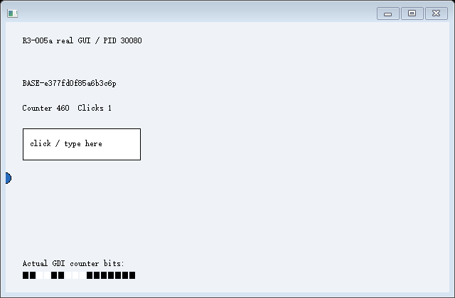
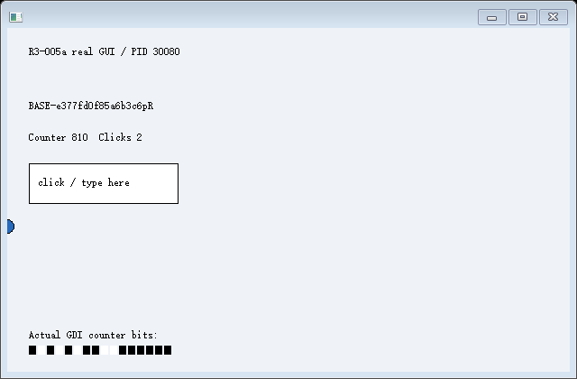

# R3-005a-CET-002：受限协作式续接及固定 GUI 整合通过

**2026-10-24，已编译并实际运行。** 编译期协作的受控程序第一次在源退出后的新进程中，从 S0 完成真实 `CheckpointTrap → leaf → middle → outer` 返回，再继续绘制和处理受管输入。14 次运行（7 个场景各两轮）、285 项证据检查符合预期；正向 EXE 返回 0，五类负向 EXE 各返回 2，总脚本返回 0。这不是 285 项能力，也不是未改造 Windows 应用恢复或完整 R3 通过。

原始链路见 [summary.json](summary.json)、[总输出](console.log) 和各场景的 `controller.jsonl`。源码基线 `2ec1d2ba22b2d720ae2b4d523273aae22373b1a5`，本轮源码/二进制 SHA256 见 [identity.json](identity.json)。旧 R3-005a/CET-001 源码、报告和失败证据未修改，没有把旧失败改写为通过。

## 环境与复现

Windows NT 10.0.26200.0，AMD64，非管理员；MSVC 19.44.35229.0、SDK 10.0.18362.0，C++20、静态 /MT。fixture 使用 `/Od /Ob0` 以审查调用位置，其余单元 `/O2`；所有相关单元保留 `/GS`、`/guard:cf`，EXE `/CETCOMPAT`。实际构建见 [build.log](build.log)、[build.json](build.json)、[PE loadconfig](loadconfig.txt) 和 [编译器产生的函数汇编](compiled-frames.asm.txt)。运行命令见 [README](../../README.md)。

目标实际 CET 策略与 CFG 策略分别读取，CET_U 由官方 XSTATE 接口从停止线程读取。没有设置或关闭系统保护、写影子栈、移植源 SSP、替换 RET、修改系统 DLL、使用驱动或虚拟机。引导汇编的入口是固定直接 CALL，未用不受 CFG 校验的间接跳转建立链。

## 具体协作内容

本实验从 R3-005a 的固定执行域分出，新增的协作位于测试程序编译边界：

1. 初始化、outer、middle、leaf 的检查点前业务代码分别受结构入口标志保护。源执行这些代码，生成 BCrypt 随机数据、未保存文本和真实局部量；目标跳过这些块。
2. 两边仍从同一 application、outer、middle、leaf 的原 CALL 位置进入下一层。目标执行正常 C++ 序言，零初始化结构局部数组；未计算、导入或重放源业务数据。CheckpointTrap 的源路径生成 R10 中间值，目标结构路径只设置不同哨兵。
3. 控制器在双方检查点，用 Windows unwind 元数据独立解析五个普通返回位置，再读各自 CET_U/SSP 下的实际影子返回地址。只有普通/影子返回逐项一致、目标与源返回关系相同、RSP/局部量地址和构建布局相同时，才接受续接。
4. 恢复原始数据页、栈、指定上下文与既有 CRT ABI cookie；GUI 场景另映射三个显式 HWND 槽。没有按变量含义填入预期结果。R11 保留目标自己的只读 SSP 观测值；没有把源 SSP 写到目标 CET 状态。
5. 写回后再次核对目标的普通/影子返回链，随后执行原检查点后的 MOV/RET、原 C++ 计算及真实 /GS 检查。最终 receipt 同时依赖原始数据页 seed、三个栈局部值与 R10。

fixture 没有业务状态导入函数或业务保存代码。编译协作只负责合法建立调用结构、跳过前半段副作用；控制器负责原始执行现场恢复。源/目标的初始化及业务前缀证据由控制器独立记录实际断点事件，没有使用随快照恢复的 init_count 自证。

## 实际 GUI 链路

[gui-1/controller.jsonl](gui-1/controller.jsonl) 保存了完整事件顺序：源随机文本为 `BASE-e377fd0f85a6b3c6p`，S0 计数 460、点击 1。源正常返回后继续改为尾部 `p!`、计数 633，再被确认退出。随后新 PID **30080** 在相同 CALL 位置构造链，到结构检查点时初始化和三个业务前缀事件均为零。

源 SSP `792491716512` 与目标 SSP `160976334752` 属于各自线程；普通 RSP 均为 `1859723001144`。目标的五个普通返回地址与其实际影子返回一致，也与 S0 返回关系一致；恢复后再次核对通过。新窗口句柄由原 `1256820` 映射为目标实际创建的 `4271472`，仅修改三个声明引用。

执行完成的 receipt 为 **9081105960780271181**，返回标记为 7；目标文本、计数和点击仍为原 S0，而不是源退出前的最新值。随后目标实际绘制计数 460、接受字符 `R` 和左键点击，画面更新到计数 810、点击 2、文本尾部 `pR`。

| 验证层 | 本轮结果 | 范围 |
| --- | --- | --- |
| 源真实内存/栈/寄存器捕获 | 通过 | 原始页、受管栈、指定 CPU 字段；原始二进制证据可独立核对 |
| 新线程合法构造返回链 | 通过 | 编译期协作的固定 CALL 结构，读真实 CET_U/影子栈 |
| 真正恢复后计算与普通返回 | 通过 | 正常 RET、三个栈局部量、数据页 seed、R10、/GS |
| 初始化和检查点前业务不重放 | 通过 | 源独立事件为初始化 1、三个前缀各 1；目标均为 0 |
| 固定窗口及已知引用重建 | 通过 | 单自绘 GDI 窗口，三个声明 HWND 槽，不扫描整数 |
| 恢复后的实际 GDI 和受管输入 | 通过 | 原应用绘制，现有字符/左键模块；非控制器拼图 |
| 任意 GUI、EDIT 内部状态、完整线程环境 | 未验证 | 不在本实验支持范围 |

源 S0：

新 PID 恢复 S0 后的真实画面：

恢复后继续输入和运行：

图像经目标绘制记录、调用时序及 PNG 中的计数像素独立核对；也已人工查看这两张恢复图。不同 PID、旧文本回到 S0、计数变化及真实输入共同构成证据，不能只看截图或哈希。`Metadata.published` 沿用旧 fixture 的私有业务启用开关；控制器完成 GDI 和输入检查后才记录对外的 `view_published`，没有把结构检查点当作可用 View 发布。

## 分开的反例

| 场景（各两轮） | 实际结果 | 排除了什么假通过 |
| --- | --- | --- |
| return-mismatch | 目标走另一处合法 CALL，自己普通/影子链仍一致；与 S0 不同，写回前拒绝 `restore.call_chain_mismatch` / Win32 13 | 不能只看 CET 开启或有一串 CALL 就接受恢复 |
| stack | 保留目标叶局部量原值；三层正常返回、标记 7，receipt 错误，`restore.execution_receipt` / 23 | 结果确实依赖原栈局部量，没有被更早的 CET 错误遮蔽 |
| register | 保留目标 R10 哨兵；三层正常返回，receipt 错误 / 23 | 不是仅恢复内存即可碰巧得到答案 |
| memory | 保留目标 seed 原值；三层正常返回，receipt 错误 / 23 | 最终计算确实消费保存的原始内存 |
| cookie | 不写回原 CRT cookie；独立触发 0xC0000409 / 子码 2 | /GS 检查真实执行；该失败没有作为其他反例的通过依据 |

每个反例都保存独立源/目标进程及实际错误，未发布可用 View。栈/内存遗漏通过保留目标对应字节的原值模拟；寄存器遗漏保留目标实际 R10。脚本从**实际待续接原始字节和寄存器**重算最终值，确认目标真实结果与这些字节一致、与正确 S0 结果不同。没有删除断言或将错误结果记为恢复成功。

## 适用边界与结论

已验证的是同机、同构建、同映像基址、同固定受管地址、单受管线程的**编译期协作续接子集**。它保留普通 C++ 函数、实际局部量和执行位置，却要求函数提供结构入口，不能支持未经改造的任意 Win32 程序。fixture 的 O0 编译及已知帧布局是本实验约束，不推导到任意优化、递归、异常展开或动态调用图。

运行时栈仍沿用旧实验预提交内存及显式 NT_TIB 边界 ABI；GetCurrentThreadStackLimits 的原生边界不一致未解决，未恢复原启动栈、TEB/PEB/TLS、自动扩栈、跨引导异常、全部系统辅助线程或完整 XSTATE。MSVC cookie/complement 属于本轮声明的 CRT ABI，未证明其他 CRT 或安全配置兼容。

GUI 是 Windows 真正重建的资源，支持一个已知自绘窗口及三个活跃引用；不是复制旧 HWND 或整个内核 GUI 对象。未恢复原生 EDIT、任意窗口树/消息队列、D3D/GPU、COM/IME 或多线程 GUI。输入与 PrintWindow 复用旧实现，没有扩展输入 API。

本轮没有执行宿主人工交互，也没有重新运行 R1～R3-004/CET-001 的完整矩阵；旧采集偶发失败及宿主不确定结论保持。本轮没有开始 R3-005b/R4，不宣称完整 R3。

微软说明硬件栈保护通过受保护返回地址进行校验，且上下文 IP 校验是另一项策略；本实验让目标正常 CALL 自己建立链，未修改这两项策略。[Windows 硬件栈保护策略](https://learn.microsoft.com/en-us/windows/win32/api/winnt/ns-winnt-process_mitigation_user_shadow_stack_policy)。/GS 和 CFG 的编译器作用分别见 [MSVC /GS](https://learn.microsoft.com/en-us/cpp/build/reference/gs-buffer-security-check?view=msvc-170) 与 [Control Flow Guard](https://learn.microsoft.com/en-us/windows/win32/secbp/control-flow-guard)。这些文档不承诺本项目的检查点机制，成功结论来自上述实际运行。
