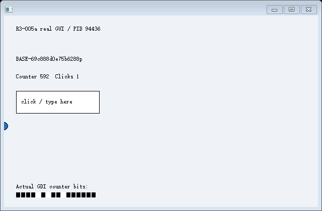
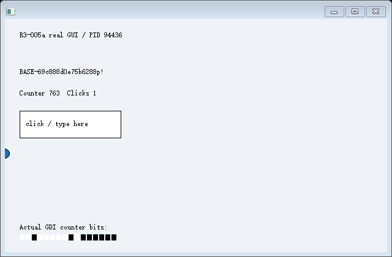
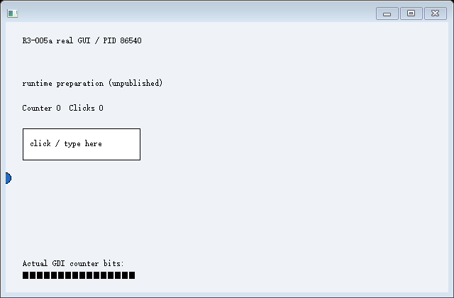

# R3-005a 实测：原始现场写回后，首个 RET 被 CET 阻断

**2026-10-24，已编译、已运行，GUI 执行恢复未通过。** 本轮交付可复现的失败，不发布可用 View，不推进 R3-005b/R4。`evidenceChecksPassed=true` 表示失败证据互相一致；`experimentPassed=false` 和进程/脚本退出码 2 才是恢复判定。

## 环境与复现

基线 `64c2c88fc8fa673dae3fb6ac1bbe8f92fc949e72`；Windows 11 x64 / NT 10.0.26200.0，非管理员；MSVC 19.44.35229.0、SDK 10.0.18362.0。C++20、静态 CRT、/GS、/CETCOMPAT，未关闭保护、未使用驱动或第三方运行库。实际构建输出见 [build.log](build.log)，构建配置见 [build.json](full-diagnostic/build.json)。

```powershell
.\experiments\r3-005a\build.ps1 -MsvcRoot 'D:\focus-distinct-browser\.tools\msvc\VC\Tools\MSVC\14.44.35207' -SdkRoot 'D:\Windows Kits\10' -SdkVersion 10.0.18362.0
.\experiments\r3-005a\test.ps1 -Scenario ret-probe -ResultsDir '<全新最小复现目录>'
.\experiments\r3-005a\test.ps1 -ResultsDir '<全新完整实验目录>'
```

完整运行 [identity.json](full-diagnostic/identity.json) 记录每个实际源文件 SHA256、系统与权限。EXE SHA256 为 `29d694e2c21c4d7078776dd554913cfdc9bc913930e30e4e4faaa78d39506735`；同一二进制用于下面三组记录。输入/采集复用旧源码，旧实验及其原始报告未修改。

## 实际执行链路与分层结果

源 PID 94436 创建真实后台窗口，业务初始化生成随机未保存文本。经现有受管输入实际输入 `p`、点击后，排空输入并解除运行时模块，在没有活动窗口过程、绘制、捕获或未完成输入的安全点保存 S0。调用栈包含正常 C++ leaf/middle/outer 函数，保留 CALL/RET 与 /GS。Windows unwind 元数据独立解析三层函数，脚本另从原始栈和 R10 重算预期计算结果。

S0 文本为 `BASE-69c888d0e75b6288p`，计数 592；源在原进程正常返回同一调用链，receipt 为 `10885178369031259058`，返回标记 7。随后源实际输入 `!`、继续更新到计数 763，再确认退出。源退出后才创建承载 PID 86540；其业务初始化和原始检查点事件均为零。

| 检验层 | 实际结果 | 证据的适用范围 |
| --- | --- | --- |
| 原始内存 | 写回、读回一致 | 4096 字节受管页；声明的 HWND 槽除外 |
| 普通 C++ 栈 | 写回、读回一致 | 固定运行时栈；声明的两个活跃 HWND 槽除外；源正常返回已验证 |
| CPU 上下文 | SetThreadContext 成功，整数/控制/SSE 读回一致 | 仅证明停止线程的指定字段写回，不证明成功续接 |
| 原生窗口资源 | 新 PID/TID 真实创建窗口，描述及引用核对通过 | 固定单自绘窗口；旧 HWND 10822420 映射为新 HWND 4400398 |
| 执行续接 | **失败** | 保存 RIP 后执行 MOV，到首个 RET 即触发 CET 错误 |
| 恢复后的真实 GDI | **未到达** | 只有源画面和未发布准备窗口的真实画面 |
| 恢复后的受管输入 | **未到达** | 源端输入有效不能替代目标恢复验证 |

原始记录为 [controller.jsonl](full-diagnostic/run/controller.jsonl)、[源事件](full-diagnostic/run/source-events.jsonl)、[目标事件](full-diagnostic/run/restored-events.jsonl)。数据、活跃栈和 CONTEXT 分别保存在 `S0-*.bin` 与 `target-*-before-continue.bin`。原始 CONTEXT 的 RIP 按检查点协议归一为 INT3 后一字节。日志记录窗口逻辑身份、描述和三个显式引用的 `resource_rebind` 映射；没有扫描内存猜测句柄。

## 最小失败：受保护返回链没有恢复

完整运行保存 RIP `140700310115025`、RSP `1859723001256`、R10 `56844910187714`。目标恢复后在 RIP `140700310115028` 失败，即三字节 MOV 之后的 RET（指令字节 `c3`）。异常码 **0xC0000409**，参数 `[57,857027375048,1073889280]`；安装 SDK 将 57 定义为 `FAST_FAIL_CONTROL_INVALID_RETURN_ADDRESS`，原始定义见 [fastfail-symbol.txt](fastfail-symbol.txt)。Fast-fail 子码通过异常参数传递，参见微软 [__fastfail](https://learn.microsoft.com/en-us/cpp/intrinsics/fastfail?view=msvc-170)。

只读诊断给出源 SSP `388652593064`，目标引导 SSP `857027375048`。普通 CONTEXT 写回之后，官方 XSTATE 接口读取的 CET_U SSP **仍为目标引导值**；其影子返回地址 `140700310357129` 与恢复普通栈上的返回地址 `140700310356773` 不同。目标硬件栈保护策略原始值为 261（0x105）。这组地址、指令、异常子码和最小复现共同定位了当前路径的受保护返回链不一致。

[ret-verified](ret-verified/summary.json) 移除输入钩子和 PrintWindow，仍用真实 GUI、普通 C++ 栈、源退出后的新进程续接，复现同一首个 RET 故障。这排除了“必须先运行输入/截图辅助路径才失败”的假设。/GS、窗口引用使用都发生在故障之后，不能声称其跨进程正确性已被证明。

本轮只用 [InitializeContext2](https://learn.microsoft.com/en-us/windows/win32/api/winbase/nf-winbase-initializecontext2)、[SetXStateFeaturesMask](https://learn.microsoft.com/en-us/windows/win32/api/winbase/nf-winbase-setxstatefeaturesmask)、[LocateXStateFeature](https://learn.microsoft.com/en-us/windows/win32/api/winbase/nf-winbase-locatexstatefeature) 配置读取缓冲区并观察 CET_U；没有写 CET_U 或影子栈、没有改页权限或关闭保护、没有用 JMP 替代 RET。普通 [SetThreadContext](https://learn.microsoft.com/en-us/windows/win32/api/processthreadsapi/nf-processthreadsapi-setthreadcontext) 成功不等于完整线程环境已恢复。

## 负向、清理和回归

| 拒绝路径 | 实际触发 | 错误 |
| --- | --- | --- |
| 构建不匹配 | 修改快照身份后进入真实比较路径 | 1306 |
| 窗口重建失败 | CreateWindowExW 使用未注册类 | 1407 |
| 无法重关联引用 | 已登记引用地址超出声明内存范围 | 13 |
| 上下文写回失败 | 仅有 THREAD_GET_CONTEXT 权限的句柄调用 SetThreadContext | 5 |

四项均拒绝发布 View。遗漏栈、寄存器、cookie 的后继实验明确未执行：当前首个 RET 故障会掩盖它们，不能把同一个失败重复记为这些检验通过。完整本轮控制器创建的 15 个进程均确认退出，6 个 Desktop 均关闭；旧回归有各自清理记录。

| 实际运行 | 控制器断言 / 证据检查 | 恢复判定 |
| --- | --- | --- |
| [ret-verified](ret-verified/summary.json) | 8 / 20，均符合诊断预期 | 未通过，退出 2 |
| [full-diagnostic](full-diagnostic/summary.json) | 18 / 28，均符合诊断预期 | 未通过，退出 2 |
| 最新完整 R3-004 回归 | 70 / 72，均符合其预期 | 既有鼠标子集保持；不是 GUI 恢复 |
| 嵌套 R3-003 / R3-002 | 分别 44 / 62、32 / 39，均符合预期 | 既有键盘子集保持 |

最新回归见 [R3-004 summary](full-diagnostic/r304-regression/summary.json) 及其嵌套目录。**还保留一次未修复的回归失败**：[full-regression-failure](full-regression-failure/r304-regression/summary.json) 的 R3-004 控制器 70 项均通过，但证据检查仅 71/72；`A.drag-actually-painted-at-routed-location` 失败。[原图](full-regression-failure/r304-regression/run/A-inside-held.png) 中整个拖拽子窗口区域未出现，顶层和 Tick 有更新。后续重跑通过不能消除这次观测；本轮没有修复该采集问题，也未改旧断言。

该次旧回归抛错使新脚本未生成总 summary；[当时脚本](full-regression-failure/harness-before-summary-fix.ps1)、原始日志、图像及旧回归 summary 全部保留。之后仅修正本轮脚本的异常收尾：回归异常保留为失败并继续写总报告，不吞掉失败。R1/R2 没修改、没重跑；宿主人工交互未执行，原 R3-004 的宿主不确定结论保持。

## 真实图像与未覆盖边界

源 S0（计数 592）：



源继续改变后（计数 763、文本追加 !）：



新进程的运行时准备窗口（业务未初始化、未发布，计数 0）：



三图均由目标真实 GDI/PrintWindow 产生，结合目标绘制日志与计数像素核对；第三张不是恢复后的业务 Frame。没有生成 `restored-S0.png` 或恢复后输入图冒充结果。

栈引导显式修改当前 NT_TIB 的 StackBase/StackLimit 并切换 RSP，整个固定栈预提交；不是复制系统原启动栈或 TEB/PEB。[GetCurrentThreadStackLimits](https://learn.microsoft.com/en-us/windows/win32/api/processthreadsapi/nf-processthreadsapi-getcurrentthreadstacklimits) 的实际下界仍为 OS 原分配栈、上界为运行时栈，已记录这项不一致。TLS、系统辅助线程、自动扩栈、跨引导异常和完整 XSTATE 均未恢复。cookie/complement 作为明确 CRT ABI 字段捕获写回，但有效性尚被 CET 故障遮蔽；没有关闭 [MSVC 安全 cookie](https://learn.microsoft.com/en-us/cpp/c-runtime-library/reference/security-init-cookie?view=msvc-170) 检查。

下一项最小研究应针对受保护返回链、CET_U 与操作系统影子栈对象生命周期，以及受支持的续接协议；仅复制旧 SSP 数值不足以重建新进程资源。本结果只否定当前“原始普通栈＋基本 CONTEXT＋固定窗口重建”路径在记录环境中的成功，不证明所有 Windows 用户态恢复不可行，也不构成直接引入完整驱动的依据。GUI 恢复关口保持未通过。
