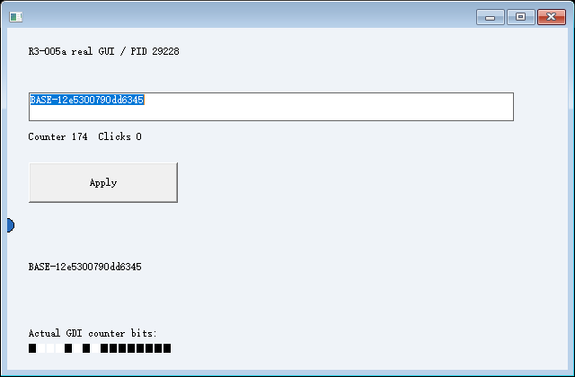
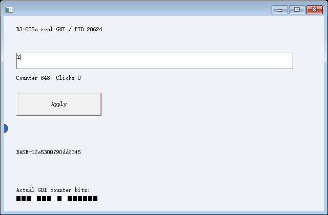

# R3-005b-001：原生 EDIT 资源及执行续接的受限整合通过

**2026-10-25：已编译、已实际运行。** 一个顶层自绘窗口、标准 EDIT、标准 BUTTON 的声明资源子集恢复通过；CET-002 执行续接通过；恢复后的真实选择、输入和绘制通过。**完整/通用 GUI 恢复与完整 R3 仍未通过，本轮未开始 R4。**

本轮 9 个场景各两次，共 18 次运行、280 项证据检查符合预期；正向 EXE 返回 0，八类拒绝 EXE 各返回 2。另实际运行未修改的 CET-002 全量回归：14 次、285 项检查通过。检查数量不是能力数量。见 [总判定](summary.json)、[总输出](console.log)、[CET-002 回归](cet002-regression/summary.json)。

## 构建与实现身份

基线 `759326d98ed5b995c49d15eba64c79acdb1c1d13`；Windows NT 10.0.26200.0 / AMD64，非管理员；MSVC 19.44.35229.0、SDK 10.0.18362.0。C++20、/MT，fixture `/Od /Ob0`；CET、/GS、CFG 保持开启，读取了进程实际安全策略。没有修改系统保护、影子栈、系统 DLL，也没有使用虚拟机、驱动或第三方运行环境。

源码和 EXE/DLL SHA256 见 [identity.json](identity.json)，实际配置和输出见 [build.json](build.json)、[build.log](build.log)、[loadconfig.txt](loadconfig.txt)。复现命令及每个 scenario 见 [README](../../README.md)。最终记录的源码与实际二进制已核对一致；旧 R1～R3/CET 源码及原始证据未改。

新文件 `resources.cpp` 是实验私有的控件资源适配器，不是应用文档导入器。`fixture.cpp` 仅在源业务初始化中生成随机未保存文本、初始化自己的 EDIT 并标记修改；目标跳过该初始化。控件的只读观察子类仍调用原始 EDIT 窗口过程，不伪造原生查询结果。键盘和输入桥直接复用未修改的 R3-004 源码，没有增加方向键或新的输入 API。

## 一致性和原生资源恢复时序

1. 源输入桥确认已接受操作全部消费、释放键态并正常解除后退出。Home＋左 Shift＋End 仅选择文本，未增加撤销历史。运行时冻结受管计算，再向**仍响应消息的 GUI 线程**提交资源服务请求。
2. 该线程原生读取窗口类、ID、样式、几何、父子关系、文本、EM_GETSEL、EM_GETMODIFY、EM_CANUNDO、GetFocus、GetCaretPos 和可检测 IME 状态。源端采集没有 WM_SETTEXT、EM_SETSEL 或清空撤销缓冲区。
3. 资源服务完成并确认支持后，应用才进入 CET 安全检查点；控制器捕获原始内存、受管栈、指定 CPU 上下文，发布 S0。`resource_result(S0)` 的记录顺序在源 `halt(checkpoint)` 之前。
4. 源继续通过原有输入入口真正修改 EDIT，并改变受管内存/计数，再确认退出。
5. 新进程创建真实窗口及子控件，在独立的运行时准备消息循环中恢复支持的 EDIT 状态、设置线程焦点、原生读回验证。完成后才建立 CET 调用链、恢复源原始执行现场，并通过正常 C++ RET 续接。

控制器没有向已停在断点的 GUI 线程同步发送控件采集或恢复消息。资源请求以运行时 IPC 传递原生状态；业务程序没有专用恢复/导入函数。目标资源重建、CPU 续接、输入验收分别记录，全部通过后才发出 `view_published`。私有 fixture 的业务启用标志不等于对外发布。

## 正向运行的原始状态

下面数据来自 [positive-1/controller.jsonl](positive-1/controller.jsonl) 和各阶段 `*-resources.json`，不是手工预设值。

| 阶段 | PID/TID | EDIT 文本 | 选区 | modified | canUndo | 焦点 |
| --- | --- | --- | --- | --- | --- | --- |
| [源 S0](positive-1/S0-resources.json) | 29228 / 12580 | `BASE-12e5300790dd6345` | 0..21 | 1 | 0 | 逻辑 EDIT 2 |
| [源继续变化](positive-1/source-changed-resources.json) | 同源 | `!` | 1..1 | 1 | 1 | EDIT |
| [目标资源准备](positive-1/target-prepared-resources.json) | 28624 / 13676 | 原 S0 文本 | 0..21 | 1 | 0 | EDIT |
| [目标执行返回后](positive-1/restored-S0-resources.json) | 同目标 | 原 S0 文本 | 0..21 | 1 | 0 | EDIT |
| [继续键盘输入](positive-1/after-input-resources.json) | 同目标 | `Z` | 1..1 | 1 | 1 | EDIT |

S0 的空撤销历史来自源程序初始安装文本后仅进行选择，快照器没有悄悄清空。源 S0 后的实际字符替换产生了撤销记录。目标恢复后重新选择、输入 `Z`、Home 和 End 均由原生 EDIT 窗口过程处理；原生查询和键/字符消息日志同时保留。继续输入自然产生新的撤销历史，后续快照仍受“不支持非空撤销”的边界约束。

S0 受管计数为 174，源继续到 357、受管文本追加 `!` 后退出。新进程正常返回得到计数 174、原始受管文本和 receipt `3996355506066924887`，返回标记 7；不是源的最新状态，也没有重新执行业务前缀。该计算由脚本从原始数据页 seed、栈局部量和 CONTEXT.R10 独立重算。

源 SSP `578009690016`、目标 SSP `145771982752` 各自属于原线程；普通 RSP 都为 `1859723001096`。目标实际普通/影子返回在写回前、后均逐项匹配，未复制源 SSP。源初始化和三个业务前缀各观察到一次；目标均为零。

窗口逻辑 ID 为顶层 1、EDIT 2、BUTTON 3，控件 ID 分别为 101/102。原生所有权查询确认父子关系、类、样式和几何；新 PID/TID 创建的新对象不沿用旧 HWND。三个数据页 HWND、四个活跃栈 HWND 共七个槽显式映射，原始字节比对仅允许这些变化。`S0-metadata.bin` 与 `target-metadata-before-restore.bin` 保留资源引用表。保证仅覆盖编译协作声明的活跃槽，不是扫描整数或发现任意隐藏引用。

## 真实图像与像素核对

源 S0：

新 PID 续接后的原生 EDIT、原选区和 BUTTON：

恢复后继续输入 `Z`：

父窗口的自绘业务文本位于 y=260，独立于 EDIT 的区域；BUTTON 也没有父窗口代绘的假标题。本实验私有图像助手请求真实 PrintWindow 后再请求原生 WM_PRINT/PRF_CHILDREN，由窗口和控件自己绘制。不是控制器根据快照拼图，也不是 DWM/GPU 合成帧；没有据此修改旧采集路径的历史结论。

脚本以目标绘制日志、调用时序和计数像素核验新帧。对 EDIT 区域排除闪烁光标列后比较源 S0 与恢复图：[像素记录](positive-1/native-control-pixels.json) 为 **12648/12648 相同**，EDIT 有 892 个可见内容像素，BUTTON 标题有 81 个黑色字形像素。第二轮独立通过；两张恢复图也已实际查看。像素不是唯一证据，还结合实际原生选区、修改/撤销状态和后续输入行为。

## 拒绝和失败实验

所有场景分别运行两轮，原生状态、API 名称、错误码和清理记录位于对应目录；预期拒绝不是对应能力成功。

| 场景 | 实际观察/错误 | 发布结果 |
| --- | --- | --- |
| undo | 实际字符输入令 EM_CANUNDO=1；`resource.EDIT.undo_history` / 50，拒绝后原文本、选区及撤销状态未变，源仍存活 | 无 S0、无 View |
| unknown-child | 原生枚举发现 3 个后代，包含额外 STATIC；`resource.unknown_descendant` / 50 | 无 S0、无 View |
| bad-parent | 目标 BUTTON 实际属于 EDIT，原生逻辑 parent=2；`resource.restore.parent_relation` / 13 | 无 View |
| unregistered-ref | 声明七个活跃 HWND，目标只登记六个；`restore.unregistered_live_HWND` / 13，CPU 写回前拒绝 | 无 View |
| omit-text | 目标实际文本仍为空；原生读回 `resource.restore.readback` / 23 | 无 View |
| omit-selection | 实际选区与 S0 不同；同上 / 23 | 无 View |
| omit-modify | 实际修改标志未恢复；同上 / 23 | 无 View |
| omit-focus | 原生线程焦点未指向 EDIT；同上 / 23 | 无 View |

负向 `S0-resources.*` 是被拒绝候选的诊断数据，不是已经发布的有效快照。各字段遗漏先由原生读回拒绝，没有用更早的 CET 失败掩盖资源验证。整个新矩阵创建的 **222 个进程均确认退出、32 个 Desktop 均关闭**，仅清理本实验拥有的对象。

## 分层结论与未覆盖项

| 层 | 结论 |
| --- | --- |
| 声明的 EDIT/父子窗口资源重建 | 通过：文本、选区、修改标志、空撤销前置条件、线程焦点、已知描述和引用 |
| 受控执行续接 | 通过：仍依赖 CET-002 的编译协作、已知帧和固定布局，正常 C++ CALL/RET |
| 本实验端到端 GUI 整合 | 通过：资源准备后续接、原生控件继续选择/输入、真实 GDI |
| 完整/通用 GUI 恢复、完整 R3 | 未通过/未验证，不能从本轮子集推出 |

只支持单 GUI 线程、固定布局、默认配置、单行 ASCII EDIT、已知字体、无水平滚动和可判定的向前选区。单行 EM_POSFROMCHAR 的 y 与 GetCaretPos 实测不等同，使用 EM_GETRECT 检查实际 y，并在目标重建后比较完整 caret POINT；文本末尾位置使用最后字符位置及原生字体度量。未将这些查询简单视为同义。

非空撤销、可检测的 IME 组合态、未知后代/类、反向或未知 caret、未知字体和不一致关系明确拒绝。IME 实际交互未执行；不支持 RichEdit、任意控件内部状态、任意 EDIT 配置、完整窗口树/消息队列、GPU、通用 HWND 发现或未改造第三方应用。

保留 CET-002 的 `/Od /Ob0`、固定地址、已知帧和 CRT cookie ABI；原启动栈、TLS、自动扩栈、完整 XSTATE 以及 GetCurrentThreadStackLimits 的边界问题没有在此解决。未执行宿主人工交互；旧采集偶发失败及宿主不确定结论不改写。除 CET-002 外，没有重跑其他旧关口。本轮没有开始 R4，也没有创建公共 SDK 或通用控件框架。

官方依据：标准 EDIT 的 [默认消息处理](https://learn.microsoft.com/en-us/windows/win32/controls/about-edit-controls) 说明 WM_SETTEXT 会清空撤销历史，因此本实验只在目标恢复阶段使用它，源采集仅查询；[EM_CANUNDO](https://learn.microsoft.com/en-us/windows/win32/controls/em-canundo) 用于识别本轮不能恢复的状态。资源消息与 [WM_PRINT](https://learn.microsoft.com/en-us/windows/win32/gdi/wm-print) 是原生机制，成功结论来自本机实际记录，不代表这些 API 提供了通用进程恢复功能。
