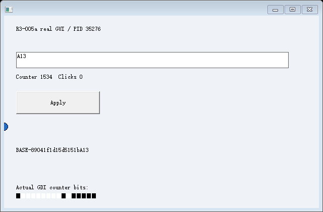
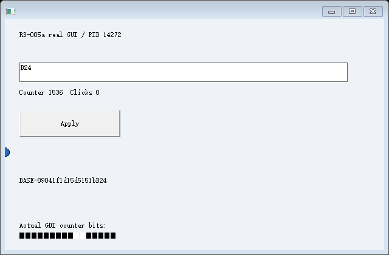
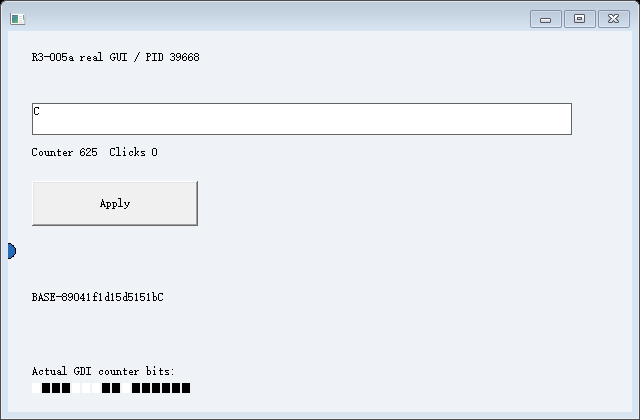

# R3-005c-001：同一 S0 的并存原生 GUI 恢复通过受限验收

**2026-10-25：已编译并实际运行。** 同一份 S0 恢复 A/B，分别编辑真实原生 EDIT 和受管内存；保持两者运行时再恢复 C，C 仍来自原始现场。三个分支随后继续输入和绘制。B 原生资源重建失败时不发布，A 继续运行，C 仍可恢复。仅限既有编译协作、固定执行布局和已声明的控件子集。

正式矩阵三个场景各两轮，**6 次运行、670 项证据检查符合预期**，脚本及各场景 EXE 均返回 0。fail-B 的成功是“准确拒绝 B 且其他分支继续”，不是 B 恢复成功。另实际运行未修改的 R3-005b-001 全量回归 **18 次/280 项**，其中实际执行 CET-002 全量回归 **14 次/285 项**，均通过。证据数量不是能力数量。

见 [总判定](summary.json)、[控制台输出](console.log)、[b001 回归](b001-regression/summary.json)、[CET-002 回归](b001-regression/cet002-regression/summary.json)。

## 身份与复现

源码基线 b156519f50da3794d0dd461876b5ee260e458499；Windows NT 10.0.26200.0 / AMD64、非管理员，MSVC 19.44.35229.0 / SDK 10.0.18362.0，C++20，静态 /MT。fixture 保持 /Od /Ob0，CET、/GS、CFG 保持开启；实际进程安全策略已读取。没有修改影子栈或系统保护，没有虚拟机、驱动、第三方运行时或宿主全局输入注入。

构建配置、输出、PE 信息见 [build.json](build.json)、[build.log](build.log)、[loadconfig.txt](loadconfig.txt)，实际源码/EXE/DLL SHA256 见 [identity.json](identity.json)。最终源码与实际测试二进制已核对一致。复现使用 [README 中的命令](../../README.md)，保留旧结果目录。

旧 R1～R3、CET-001/CET-002 和 b001 的源码、原始证据均未改；本轮只私有复制并修改新实验。除上述两套实际回归外，没有重跑其他旧关口，也不改写旧失败。

## 统一事件泵与不可变 S0

所有 GUI 进程由同一个调试线程创建。唯一 WaitForDebugEvent 入口按 PID 找到 Child，再检查线程归属；每个 Child 保留自己的事件、停点、等待期限、阶段、异常和退出状态。等待一个分支或其辅助进程时，仍正常处理另一个分支的事件。原来的“当前 Child 必须消费所有事件”已移除。

Windows 实际报告的 B/C 准备断点，在正确分支中保留。负向校验将该事件副本交给 A 的归属检查，返回 ERROR_INVALID_OWNER (1307)，A 的状态及 B/C 的真实待续事件不变；错误 TID 也被拒绝。这是校验真实事件副本，不是向 Windows 注入假的调试事件。正式日志的每条 debug_route 还独立核对 eventPid=recipientPid、TID 归属及唯一 ownerThread。

调试事件提供的进程/线程句柄遵循 Windows 在继续 EXIT 事件时关闭的生命周期，不在 CREATE 事件时提前关闭；CreateProcess 返回的控制器自有句柄另行持有，图像/DLL 文件句柄单独关闭。依据：[WaitForDebugEvent](https://learn.microsoft.com/en-us/windows/win32/api/debugapi/nf-debugapi-waitfordebugevent)、[ContinueDebugEvent](https://learn.microsoft.com/en-us/windows/win32/api/debugapi/nf-debugapi-continuedebugevent)。

S0 只发布一次，随后作为 const Snapshot 传给每个恢复。分项哈希覆盖原始数据页、完整受管栈、CONTEXT、原生资源图、Metadata/引用表、五个返回位置、cookie/计算 ABI 和 EXE 摘要。脚本从 S0-*.bin 独立重算分项及整体 SHA256，而不是只信控制器的“没有改变”断言。各阶段恢复及输入后再次核对整体指纹。

## 实际 ABC 运行

以下来自 [ABC-1/controller.jsonl](ABC-1/controller.jsonl)：

| 对象 | PID / GUI TID | 初始恢复文本及选择 | 后续真实 EDIT |
| --- | --- | --- | --- |
| 源 | 36784 / 41444 | BASE-89041f1d15d5151b，0..21 | 保存后继续修改，再确认退出 |
| A | 35276 / 40708 | 原 S0，0..21 | A → A1 → A13 |
| B | 14272 / 15580 | 原 S0，0..21 | B → B2 → B24 |
| C | 39668 / 10228 | 原 S0，0..21 | C |

四者使用各自的原生 Desktop；目标初始 modified=1、focus=EDIT、canUndo=0。C 的 [原生查询](ABC-1/C/initial-resources.json) 保留原文本、选区、caret 和父子关系，没有继承 A/B 的非空撤销历史。

S0 的受管计数为 144；A/B/C 的真实返回结果均依赖保存的数据页 seed、三个栈局部量和 R10，receipt 为 **10999658706942461710**，returned=7。源初始化及三个业务前缀各一次，目标均为零。每个目标正常/影子返回在写回前、后各核对五项，正常完成 leaf/middle/outer RET，不复制源 SSP：

| 源 SSP | A SSP | B SSP | C SSP |
| --- | --- | --- | --- |
| 458719489952 | 1076927393696 | 1075561099168 | 344550535072 |

每个分支重新创建自己的顶层/EDIT/BUTTON，七个显式 HWND 槽分别重关联。脚本独立比对目标原始页和活跃栈，除这七处外均与 S0 相同。

创建 C 前后，A 的计数 **963→1110**、B **971→1114**，各自 EDIT 仍为 A1/B2，选区、焦点、撤销和非时钟业务状态保持。日志确认它们未处于调试停点或运行时冻结。随后交错输入继续成功。正常根窗口字符输入还让受管文本分别成为原 BASE 加 A13/B24/C，证明独立变化不仅发生在控件内部。

S0 的整体指纹始终为：

~~~text
dbe23377ff53b6a695708ae80f638ba3e5495a047178147c1f2e15cd83d5a99a
~~~

其他场景、第二轮拥有自己的随机源数据和指纹；不要求不同源的 S0 相同。

## 真实 Frame 与采集诊断

最终 A：

最终 B：

最终 C：

已实际查看上述图像。每个分支的初始 EDIT 区域与源 S0 进行像素比较，排除闪烁光标列；本例 A 为 **12648/12648 相同**，且有 902 个内容像素。不是只比较图像哈希；每帧还核对图内计数、目标绘制事件、时间区间和独立分支路径，结合实际原生查询及后续字符处理。

开发诊断中，先前跨进程 DC 绘制请求在持续重绘时出现客户区空白，确实被拒绝：[实际失败图](diagnostics/cross-process-dc/rejected.png)、[具体像素/API 错误](diagnostics/cross-process-dc/failure.json)、[控制器记录](diagnostics/cross-process-dc/AB-controller.jsonl)、[该中间构建的源码哈希](diagnostics/cross-process-dc/identity.json)、[失败矩阵输出](diagnostics/cross-process-dc/console.log)。这些属于中间构建诊断，不计入正式成功矩阵；不能用后来的有效图覆盖失败图，也未据此认定所有跨进程 GDI DC 都不可用。

正式实现新增实验私有 capture.cpp：目标 GUI 线程创建本进程的 DIB/DC，对真实窗口树发送 WM_PRINT，应用原来的 WM_PRINTCLIENT 和标准控件自己绘制，GdiFlush 后传输真实像素。桥进程仅检查并编码 PNG。记录的实际 API 为 **owner-GUI-thread/WM_PRINT/native-DIB**；继承的断言文案仍用 PrintWindow/WM_PRINT 助手这一名称，实际执行路径以 API 字段和 capture.cpp 为准。没有控制器按业务数值画图，没有冻结已发布 A/B/C，也没有自动重试失败帧。

这是声明窗口树的运行时协作 GDI 取图，不是 DWM/GPU 合成帧，也没有修复或改写旧实验独立采集路径的历史限制。[WM_PRINT](https://learn.microsoft.com/en-us/windows/win32/gdi/wm-print) 和 [GdiFlush](https://learn.microsoft.com/en-us/windows/win32/api/wingdi/nf-wingdi-gdiflush) 的用途与本轮实测分别记录。

## B 失败隔离

[fail-B-1](fail-B-1/controller.jsonl) 的 B 真实 BUTTON 属于 EDIT，原生资源读回 logical parent=2；resource.restore.parent_relation 返回 ERROR_INVALID_DATA (13)。B 没有 view_published，也未进入恢复执行结果。其进程退出、Desktop 关闭后才创建 C。

A 在该失败前后计数 **282→390**，原 EDIT/选区/焦点与受管文本保持；随后真实编辑、绘制为 A3。C 仍从该场景 S0 的原文本和空撤销状态恢复，再编辑为 C。该场景自己的 S0 各阶段指纹一致；第二轮独立重复通过。

正式新矩阵创建 **338 个进程，均确认退出；22 个 Desktop 均关闭**。回归有各自清理记录。只清理本实验创建的对象。失败隔离及正常关闭输入桥均有原始日志，没有回退到宿主输入。

## 结论边界

- 通过：本实验受限 GUI 的同一 S0 重复恢复、A/B/C 并存交错输入、声明内存与原生控件隔离、B 创建失败后的 A/C 继续。
- 仍依赖编译期协作、同构建固定地址、/Od /Ob0、已知调用帧、七个声明 HWND 和 CRT cookie ABI。原启动栈、TLS、完整 XSTATE、异常展开/优化代码及原生栈边界问题没有解决。
- EDIT 保持既有单行 ASCII、默认配置、已知字体、无水平滚动、向前选区和空撤销快照前置条件；不支持 RichEdit、任意控件/窗口树或未改造应用。
- A/B/C 修改后 EM_CANUNDO=1，只保留并继续运行，**没有保存可恢复 SA/SB**，没有 Artifact、成果私有导入或合并。
- 本轮并存持续时间仅覆盖日志记录的交错流程，不代表长期稳定性或跨管理进程/宿主重启持久性。
- 宿主人工交互未执行；不宣布完整 R3、通用 GUI 恢复或完整 R4。本轮未开始 R4。
