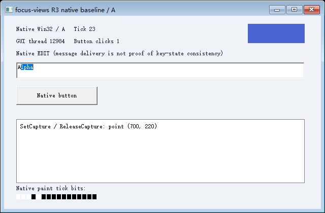
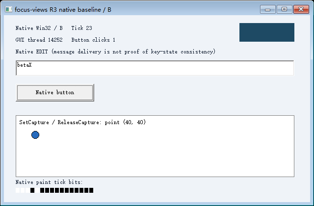

# R3-001 原生后台图形与输入诊断报告

日期：2026-10-24（Asia/Shanghai）。基于 `main@d4a3d0b`，在 Windows 11 x64 实际构建和运行。**诊断完成，R3 整体未通过；没有做 GUI 快照保存或恢复。**

本次提供了真实 Win32 程序、后台桌面及桥接进程、原生查询和绘制日志、图像及可复现的失败路径。最终结果以 [suite-final/summary.json](suite-final/summary.json) 为准。45 项证据检查符合预期，不表示 45 项图形/输入能力已支持。

## 环境与实现范围

Windows 11 家庭版 x64，10.0.26200，非管理员；MSVC 19.44.35229、Windows SDK 10.0.18362.0，C++20，`/O2 /MT /W4 /WX /DUNICODE /D_UNICODE`，链接 `/DYNAMICBASE /NXCOMPAT /CETCOMPAT`。见 [实际构建输出](build.log) 和 [原生依赖](dependencies.txt)。所有源文件、未修改的共享头文件及可执行文件 SHA256 均在汇总中。

测试程序自行创建正常顶层窗口、原生 EDIT/BUTTON、使用 SetCapture/ReleaseCapture 的拖拽子窗口和 100ms 更新的 GDI 计数区域，使用正常消息循环。没有控制器绘制界面，没有业务状态恢复命令，没有自定义 Ctrl 或捕获状态表，也没有修改系统安全设置。

A：PID **40924**，GUI tid **12984**，桌面 `fv_r3_22032_10360234_1_A`；B：PID **44592**，GUI tid **14252**，桌面 `fv_r3_22032_10360234_4_B`。各次桥接进程均在目标相同桌面运行；共享内存只用于命令回应及只读观测。它们是新启动的实例，不是从 S0 恢复的分支。

## 逐项结论

| 场景 | 本机结论 | 证据边界 |
| --- | --- | --- |
| 后台原生窗口、无预览执行 | 通过 | A/B 自己的 GUI 计数前进，未打开预览 |
| 正常运行时 GDI PrintWindow | 通过本 fixture 路径 | 9 张主实验 PNG 各有独立像素解码及目标绘制记录 |
| 普通字符、按钮 | 定向消息部分有效 | WM_CHAR 改变原生 EDIT；鼠标消息使原生 BUTTON 产生 BN_CLICKED，不等于真实键鼠输入 |
| Ctrl 消息与队列键态 | 未通过 | A 收到 WM_KEYDOWN，但 GetKeyState/GetKeyboardState 的按下位为 0 |
| 后台 GetAsyncKeyState | 未通过目标要求 | Ctrl 按下消息期间仍为 0；符合非活动桌面的已知限制，不能单凭 0 区分键抬起或接口限制 |
| 键盘 Shift+End 选择 | 未通过 | 选区为 5..5；原生 Shift 查询没有按下位 |
| 定向鼠标选择 | 部分有效 | 原生 EDIT 实际选出 1..5；仍是向指定 HWND 发消息 |
| A 捕获/焦点，B 交错操作 | 查询层面保持 | A 的 GetCapture、GetFocus 及坐标保持；B 按钮和文字独立变化 |
| 原生鼠标按键状态 | 未通过 | 消息带 MK_LBUTTON，但 GUI 线程的按键查询未显示按下 |
| 越界鼠标捕获路由 | 未验证 | 越界消息明确指定了 A.drag，不能据此证明系统会路由真实输入 |
| 创建失败、A 挂起或退出时 B 继续工作 | 通过所测路径 | 失败资源回收，B 的计数和取图继续 |
| A 挂起时采集 | 明确超时且无图 | PrintWindow 已进入，1500ms 后助手终止并确认退出，不返回旧图 |
| 采集取消后的 A | 执行恢复，重新采集未确认 | A 的 GUI Tick 继续前进；再次采集没有新增绘制记录，被严格拒收 |
| 宿主静止观测 | 最终运行不确定 | 有外部输入，不能将整体观测写成静止阶段通过 |
| 人工宿主交互 | 未执行 | 提供步骤，自动保持模式不代替人的判定 |

## 图像与绘制链路

控制器只启动同桌面采集助手。助手调用 PrintWindow 到内存 DIB，再通过系统 WIC 编码 PNG；不修改 RGB 业务图像。目标自己绘制十进制 Tick 和黑白位标记，测试脚本用 System.Drawing 从 PNG 再次解码，而非仅使用图像哈希。

主实验 A/B 初图均为 Tick **5**，之后无预览的取图均为 Tick **12**，输入后的图为 Tick **23**。每张可用图的 Tick 都处于 API 调用前后观测范围，调用期间目标绘制计数增加，并在同一目标 GUI 线程的绘制日志中找到对应 Tick 和时间。见 [控制器记录](suite-final/run/controller.jsonl)、[A 事件](suite-final/run/A-events.jsonl)、[B 事件](suite-final/run/B-events.jsonl)。

首轮曾把 WM_PRINT 当作必经路径，导致 PrintWindow 返回 TRUE 但被校验拒收。本机探针实际记录到的是 WM_PAINT，原始图中已有目标自行绘制的 Tick 2。保留 [最小探针记录及未验收原图](paint-probe-rejected/controller.jsonl) 与 [原图](paint-probe-rejected/capture-probe.png.unverified.png)。该原图只是早期诊断证据，不计入最终 9 张通过验证的图像。

之后改用实际绘制记录和可见像素 Tick 建立证据，未删除新鲜度断言或改成控制器绘图。[最终最小取图复现](suite-final/probe-capture/controller.jsonl) 已运行。该结果只说明这个 GDI fixture 的 PrintWindow 路径有效，不证明复制了 DWM 合成帧，也不覆盖 GPU、Direct3D 或任意应用。

## 输入：消息、查询、行为分别核对

最终 A 的 Ctrl-down 观测：消息次数 1，GetKeyState(VK_CONTROL) 为 **1**，GetKeyboardState[VK_CONTROL] 为 **1**，GetAsyncKeyState(VK_CONTROL) 为 **0**。前两个值的按下高位均为 0；不能把无意义的低位 1 当作按下。GetKeyboardState 调用本身成功。B 的 Ctrl 消息次数仍为 0、按下高位为 0。

这些原生接口直接在目标 GUI 线程中调用，事件的 queryThread 与 GUI tid 逐条匹配。另有 SendMessageTimeout 的 Ctrl 对照，未用 SetKeyboardState、AttachThreadInput 或替代返回值“修正”结果。[最小 modifier 复现](suite-final/probe-modifier/controller.jsonl) 单独保留了同样的消息/查询不一致。

A 拖拽时 GetCapture 为 **4459494**，恰为 A.drag；GetFocus 为 **4720672**，为 A.edit。B 完成按钮点击和字符输入后，这些值和 A 的坐标 **(100,60)** 保持。消息的 MK_LBUTTON 位与三个原生按键查询的按下位不一致。

随后明确投递到 A.drag 的越界坐标 (700,220) 能改变程序的拖拽坐标，但这是“指定目标收到消息”的证据，**不是系统捕获路由的证据**。未使用物理光标或宿主输入流验证越界路由，因此没有将其标为支持。

## 宿主、失败与清理

50ms 间隔采样前台 HWND、输入桌面、物理光标和 GetLastInputInfo。本次最终运行记录 **87** 个样本、**49** 个外部输入变化间隔、无输入变化间隔内状态变化 **0** 次、API 错误 **0** 次。整体仍标记 inconclusive，不把操作者自己的动作误算为串扰，也不据此声称人工交互已通过。[宿主原始记录](suite-final/run/host.jsonl)。

故意创建不存在的第三个实例程序时，CreateProcessW 返回 ERROR_FILE_NOT_FOUND / 2，临时映射、就绪事件和桌面回收，A/B 保持运行。

挂起 A 的 GUI 线程后，采集助手确已进入 PrintWindow；控制器在 1500ms 截止时终止该助手、确认其进程退出，记录 ERROR_TIMEOUT / 1460，并且不发布图片。B 在此期间仍被观察和采集。A 恢复后 Tick 继续更新。

取消后的 A 再次调用 PrintWindow 返回 TRUE，图像位标记仍匹配当前 Tick，但调用期间绘制计数没有增加；本实验采用更严格的“调用期间确有目标绘制”条件，所以拒收，并保留 API=validate、错误 13。**这不证明 Windows 返回了旧图，也不表示 A 不能继续运行**；它说明当前采集确认契约在取消后尚不能保证恢复。见 [最小 capture-recovery 复现](suite-final/probe-capture-recovery/controller.jsonl)。没有通过放松断言将其改判成功。

A 正常退出后再次采集，旧 HWND 的 PID/TID 身份验证失败，ERROR_INVALID_WINDOW_HANDLE / 1400，不调用绘制或返回旧图。B 之后仍运行并产生新图。被拒收的三次主实验请求均无 PNG 或 partial 文件。

主实验及三个最小探针都逐 PID 核对创建/退出，逐桌面核对创建/CloseDesktop 成功；无清理错误，无残留本实验进程。额外 [保持模式冒烟记录](hold-smoke/controller.jsonl) 验证了保持期间仍会投递输入，但没有人工审核，因此不算人工交互通过。

## 下一项最小实验与未覆盖范围

优先的 R3-002 候选是 **Ctrl 投递与原生查询一致性**：保留本轮原生对照，分别定义取出消息后的 GetKeyState/GetKeyboardState 与当前状态 GetAsyncKeyState 的语义，再研究最小运行时介入；A 的消息与状态一致、B 不受影响、抬起后恢复。测试程序仍调用原生接口，不改成读取自定义状态。尚未选择或验证具体 Hook、线程输入机制或驱动，不能推导一层介入即可兼容所有软件。

采集取消后的确认契约是另一条已定位的后续问题，不能用成功的正常取图掩盖。GUI 对象保存/恢复、普通调用栈/TLS、输入源完整虚拟化、IME、Raw Input、GPU/DWM、未改造第三方应用和人工宿主交互均未验证。

本轮没有修改 shared/common、R1 或 R2 源码与构建脚本；既有实验保持原有结果，没有以未执行的回归宣称重新验证。没有推进 R3-002 或 R4。
