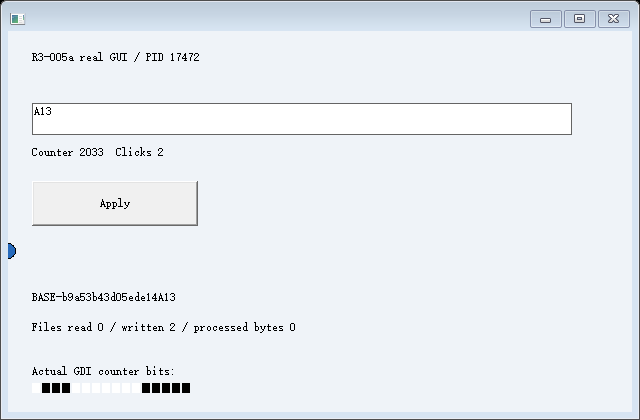
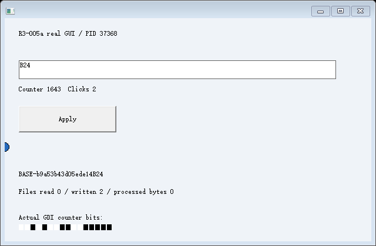
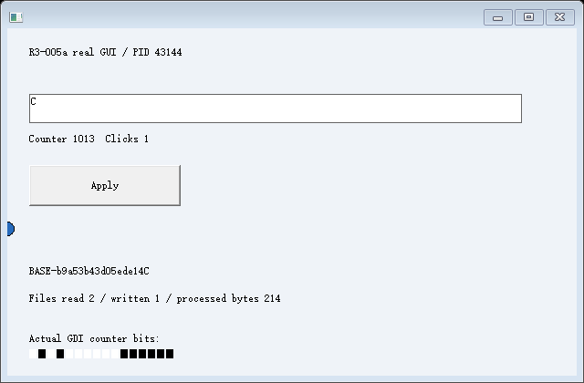

# R4-001：固定成果流实测完成，完整回归未通过

**2026-10-25，已编译、已实际运行。** 最终常驻桥版本的 R4 本体四个场景各两轮，**8 次均完成，2,859 项本体证据检查通过**：应用生成文件、固定 A-v1/B-v1、A 产生 v2、C 从 S0 恢复后读取及修改私有副本、失败候选回滚、SA/SB 非空撤销拒绝均有记录。

**不能把整套脚本写成全绿。** 2,860 项总检查中，旧回归汇总检查失败，脚本返回非零。未修改的 c001 发生 PID 复用清理检查误报，嵌套 b001 又遇到 CreateProcessW / ERROR_ACCESS_DENIED (5)，随后脚本停止，CET-002 本次未运行。原 [summary.json](summary.json) 的 allEvidenceChecksPassed 和 declaredArtifactFlowPassed 都为 false；[assessment.json](assessment.json) 仅分层列出 R4 本体与回归，不替换原判定。

## 环境、身份和复现

基线 ac9e485a7293fc5fdc9183bd8ea43e73f22b2401；Windows NT 10.0.26200.0 / AMD64、非管理员，MSVC 19.44.35229.0、Windows SDK 10.0.18362.0。C++20、/MT，fixture /Od /Ob0，CET、/GS、CFG 保持开启并读取实际策略。没有虚拟机、驱动、第三方运行时或系统安全设置变更。

见 [源码/二进制 SHA256](identity.json)、[构建配置](build.json)、[实际构建输出](build.log)、[PE loadconfig](loadconfig.txt)、[控制台记录](console.log) 和 [复现命令](../../README.md)。最终源码与实际运行二进制已核对一致。旧实验源码、历史失败和原证据没有修改；本轮实现均为实验私有代码。

## 真正生成成果、再处理私有副本

应用的普通文档功能位于 application.cpp。控制器只写操作种类、Action 序号及路径，然后经原有受管鼠标入口点击真实 BUTTON。原生 BN_CLICKED 使应用读取自己的 EDIT、恢复后的 seed/receipt，实际调用 CreateFileW、WriteFile、FlushFileBuffers、CloseHandle。控制器不提交成果正文，也不调用按钮业务函数代替输入。

运行时在应用确认完成、文档句柄已关闭后读取分支文件，核对真实长度和应用 SHA256，复制到新临时版本。完整内容及来源清单写完并验证后，同卷重命名目录才发布。运行期间固定内容和清单持有不共享写入/删除的只读句柄，另设置只读属性；每次导入仍校验内容。Artifact 与工作文件为不同文件对象。

C 先完成来自原 S0 的 CPU/内存/控件续接，再接收两个固定版本的私有文件副本。它的应用通过正常 ReadFile 读取两份内容，追加自己的修改，并产生同时依赖两份输入及本地 seed 的结果。不是把 A/B 内存写进 C，也不是以文档读取冒充 Snapshot 恢复。

下面来自 [positive-1/controller.jsonl](positive-1/controller.jsonl)：

| 对象 | PID / GUI TID | 初始状态 | 最后原生 EDIT / 应用文件计数 |
| --- | --- | --- | --- |
| 源 | 37144 / 39644 | BASE-b9a53b43d05ede14、选区 0..21、计数 224 | 保存后变化并确认退出 |
| A | 17472 / 43884 | 从 S0 真正恢复 | A13，生成文档两次 |
| B | 37368 / 37956 | 从 S0 真正恢复 | B24，生成文档两次 |
| C | 43144 / 41972 | 原始 BASE、原选区及空撤销 | C，读取两份、生成结果一次、处理 214 字节 |

三者均完成真实 CALL/RET，receipt 同为 **8523344348317828427**，returned=7，业务初始化/前缀没有重放。每个目标独立重建既有窗口及七个显式 HWND 引用、自己的 CET 返回链和输入通道。S0 在成果发布、私有处理和拒绝尝试之后的整体指纹均为：

~~~text
1e09389317a3a6fb67f1a818bf27ad245cf4c788f67f591ab07b0755bd53c498
~~~

## 固定版本与 C 的实际读取

| 版本 | 来源 / 产生它的 Action | 字节数 | SHA256 |
| --- | --- | --- | --- |
| [A-v1](positive-1/artifacts/A-v1/manifest.json) | A / A-5 | 107 | 618aae85a7c36b074deaff40872f865eef1b7bf7b987179aec74984a26338471 |
| [B-v1](positive-1/artifacts/B-v1/manifest.json) | B / B-5 | 107 | fd056c5dd511ffa34edf536e8c801dd63f58c04e4c8acdbd7cff7276a172f504 |
| [A-v2](positive-1/artifacts/A-v2/manifest.json) | A / A-12 | 109 | b425e92090e4df5bf8adc56cc06919ae57f7d9ea12a55ba67365b5347cd1956b |

每个目录保留实际 data.bin。A 后续工作文件及 A-v2 含 A13，A-v1 仍含 A1；B 工作文件后来含 B24，B-v1 仍含 B2。来源、版本、Action 和数据哈希在 C 修改后再次核对，未变化。

[C 的原生文件回执](positive-1/C/file-effects.jsonl) 记录目标 PID/TID、ReadFile 实际字节、两次读取、三次写入/刷新、五次文档句柄关闭，liveHandles=0；readA/readB 与固定 A-v1/B-v1 逐字节一致。

- [C 私有 A 文件](positive-1/workspace/C/imports/A.txt)、[私有 B 文件](positive-1/workspace/C/imports/B.txt) 含原版本及 C-private-edit 标记。
- [C 的实际处理结果](positive-1/workspace/C/processed.txt) 使用两份实际读取内容及 C 的 S0 seed；脚本独立重算结果和 SHA256。
- [A 工作文件](positive-1/workspace/A/document.txt)、[B 工作文件](positive-1/workspace/B/document.txt) 的最终字节仍与各自第二次应用 WriteFile 回执一致。

## Action 与真实画面

[positive-1/actions.jsonl](positive-1/actions.jsonl) 有 50 个 Action、200 条状态记录；两条 failed 是真实的 SA/SB 拒绝。最终八次本体运行共 **406 个 Action、1,624 条记录**。每 View 序号单调，submitted/accepted/delivered/effect_confirmed 或 failed 分开，链接原生 GUI 查询、独立输入日志或应用文件回执。

delivered 是控制器确认投递的观测点，可能晚于目标实际处理；原始桥/目标日志保留实际时序。输入批次的确认仅表示其原生处理后的 GUI 查询成立，不代替文档完成；文档 Action 还必须等待目标文件回执、关闭状态和实际文件校验。账本不提供确定性业务重放。

上述图像已实际查看。C 的界面显示 Files read 2 / written 1 / processed bytes 214。图像来自目标 GUI 线程的原生 WM_PRINT/DIB，桥仅编码像素，结合目标绘制日志、计数像素、初始 EDIT 像素和原生状态验收。没有根据业务数据在控制器拼画面。

## 失败、原子发布与撤销历史

| 场景，各两次 | 实际拒绝与后续证据 |
| --- | --- |
| export-interrupt | 在声明的半份临时文件完成点主动取消，artifact.export_interrupted / 995；候选不发布、临时目录移除，原 A-v1/B-v1 保持。后来的 A-v2 是另一条正常 Action。不是任意崩溃恢复测试 |
| hash-mismatch | 只破坏导入临时 B 副本一个字节；artifact.import_hash / 23，整批回滚，原 Artifact 与 C 原状态不变 |
| import-failure | 第二份临时文件用只读句柄，真实 WriteFile.artifact_stage / 5；已复制的第一份也回滚，无半成品 imports |
| SA/SB | 正常关闭输入并冻结后调用原资源采集适配器，EM_CANUNDO=1，resource.EDIT.undo_history / 50；文本、选区及撤销保留，不发布 Snapshot，再恢复运行 |

失败 Action 一直保留 failed；新正常操作使用不同 Action，不静默重试。每个结果目录均确认没有残留 .partial。两次 SA/SB 拒绝后都重新核对新输入通道/IAT 事务及正常退出。Artifact 不是可恢复 SA/SB 的替代品。

## 常驻桥、诊断和回归红项

早先逐操作助手的两组正式记录在 [开发记录目录](../20261025-r4001/README.md)，各有一次 CreateProcessW / 5，原始 summary 均保留失败。最终使用每 View 一个常驻 courier，按序复用控制和采集；命令超时或进程退出明确失败，结束时确认退出。没有为通过测试自动重试创建或重放操作。最终八次各 15 个显式创建进程，共 **120 个实例均确认退出、32 个 Desktop 关闭**。这不能证明创建永远不会被系统拒绝。

新实现以实例序号匹配进程创建/退出，允许退出后的 PID 复用。旧 c001 的 ABC-1 原清理断言失败；[独立按时间顺序审计](baseline-cleanup-lifetime-audit.json) 确认 76 次创建/退出配对、PID 32644 被退出后复用、无未结束记录。**该审计不把旧测试改记为通过。**

本次 [c001 完整回归记录](c001-regression/summary.json) 仍为 false：还有嵌套 [b001 创建拒绝](c001-regression/b001-regression/positive-1/controller.jsonl)，随后脚本因缺少 S0 记录停止。CET-002 在这次回归中未执行。较早逐操作构建运行中 [c001/b001/CET-002 曾全部通过](../20261025-r4001/c001-regression/summary.json)，是另一次实际记录，不覆盖本次红项。没有重新运行 R1/R2。

相关近期安全日志未找到本程序对应记录，CreateProcessW / 5 的具体原因未确认；没有禁用保护或归因于某个安全产品。

另保留两项开发失败：

- [首次静态 CRT 使用异常](../20261025-r4001/diagnostics/static-crt-first-use/fault.json)：0xC0000005，首轮封装返回位置落在 CRT 首次初始化路径。当前应用改用 to_chars 和原生文件日志；没有证明根因仅是格式化或 cookie，也没有宣称完整 CRT/TLS 恢复。
- [输入重新安装拒绝](../20261025-r4001/diagnostics/input-reinstall-before-retirement/reinstall.jsonl)：已恢复的旧 IAT 事务对象仍可能留在未卸载模块。私有 runtime.cpp 仅在两个槽、页权限、pinned/restored 状态全部核对成功后退休对象，让下一通道建立新事务；旧 R3-004 源码不改，失败时仍保留引用。

## 能力范围

本体成果流得到重复实测证据；**完整测试脚本未通过，不能称全部验收或回归全绿**。只支持本实验管理的已完成、关闭句柄的普通同步小文件和指定路径/版本协议，不扩展 R2 为任意 GUI 文件系统隔离。

版本只读句柄/属性和逐次校验是本协议的管理约束，不是同用户任意程序或管理员的安全沙箱。未验证跨管理进程重启、断电、远端文件系统、任意崩溃点或长期稳定性。Snapshot 仍限于原 CET-002 编译协作、固定布局、单 GUI 线程和既有受限 EDIT；非空撤销、任意控件、完整 CRT/TLS 及通用应用均未解决。

**可恢复 SA/SB、完整 R4 均未实现，宿主人工交互未执行。** 运行时只发布和复制指定成果；文档处理是本测试应用的业务逻辑，不提供运行时自动状态合并。
