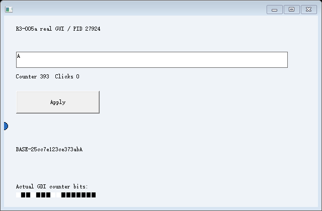
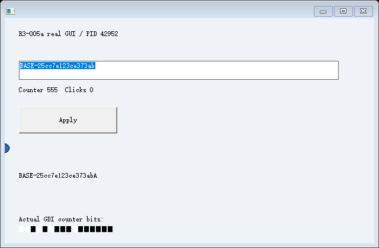
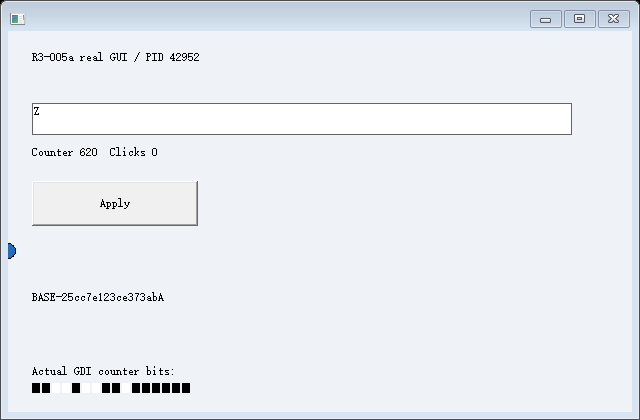

# R4-002a：单次 Undo 与修改后 SA/SB 的受限恢复通过

2026-10-25 在 Windows 11 x64（NT 10.0.26200）实际构建和执行。基线提交 `0f5028a4`，新增实验源码的完整 SHA256 清单见 [identity.json](identity.json)，实际构建 ID `581fd0de25a26b38aa74774e639df5f595a18b2ace077d92fdf29c74bd35bf1e`。MSVC 19.44.35229.0、Windows SDK 10.0.18362.0、C++20、静态 CRT；fixture 为 /Od /Ob0，/GS、CFG、CETCOMPAT 保持，所有被恢复进程的实际 CET/CFG 策略均检查启用。没有修改系统保护。

结论仅覆盖已知窗口树、单 GUI 线程、单行 ASCII EDIT、固定内存/普通 C++ 帧和编译期协作的检查点。本轮首次保存真实编辑后的 SA/SB，并在原 A/B 退出后恢复到新 PID，完成原始计算及真正 CALL/RET，继续原生 Undo、输入和绘制。完整 R4、任意应用、任意 Undo 历史、稳定磁盘协议或崩溃恢复均未完成。

## 正式矩阵

最小原生 Undo 对照运行 2 次；以下十个集成场景各 2 次，共 20 次。正式脚本返回成功，顶层 [summary.json](summary.json) 的 1,674 项证据检查全部通过，20 个控制器共 1,074 项断言符合预期。反例准确检测不等于对应恢复成功；只有两个 positive 场景的 `terminalRestorePassed=true`。

| 场景 | 实际结果 |
| --- | --- |
| positive | 同一 S0 恢复 A/B；各真实替换一次、修改受管内存，保存 SA/SB；确认 A/B 退出；新 PID 恢复各自状态、正常 RET、原生 Undo 两次、继续输入和 GDI |
| multiple | 两次真实 WM_CHAR 后拒绝推测合并 Undo，不能发布终态 Snapshot |
| IME | 合成 WM_IME_STARTCOMPOSITION 使观察记录失效，拒绝 Snapshot；未测试真实 IME 组合态 |
| unknown-edit | 未支持路径上的原生 EM_REPLACESEL 使记录失效，拒绝 Snapshot |
| no-undo | 故意用 EM_REPLACESEL(FALSE) 重建，实际 CANUNDO 读回不符，在资源阶段拒绝且不发布 View |
| wrong-undo | 故意重建错误字符，实际文本读回不符，在资源阶段拒绝且不发布 View |
| stack | 故意遗漏必要栈局部量；正常 CET 返回后实际 receipt 错误，拒绝 View |
| register | 故意遗漏 R10；正常返回后实际 receipt 错误，拒绝 View |
| memory | 故意遗漏原内存 seed；正常返回后实际 receipt 错误，拒绝 View |
| bad-chain | 真实进入不同 CALL 位置，普通/影子返回关系与快照不匹配，写回前拒绝 |

## 控件资源机制与源状态

[最小原生记录](native-undo-1.jsonl) 比较三个独立标准 EDIT：采集源、执行相同真实 WM_CHAR 的原生验证控件、由资源适配器重建的目标。运行时在消息前后查询实际状态，没有向采集源发送 Undo、清空历史或补写业务文本。源在验证后仍与采集时相同。

实际序列为随机 `BASE-…` 全选 → `A`、选区 1..1、modified=1、canUndo=1；第一次原生 EM_UNDO 恢复随机原文及全选；第二次 EM_UNDO 回到 `A`、选区 0..1。原生对照与重建控件的结果、选区、修改标志、CANUNDO 均相同；随后 WM_CHAR `Z` 的原生效果也一致。这里的第二次 Undo 是标准 EDIT 反转上一次 Undo 的行为，不是宣称多级撤销队列。

集成实验的 A/B 字符由既有受管输入桥投递给原生 EDIT，fixture 的原生窗口过程负责编辑。资源运行时记录消息、线程及实际前后状态，捕获前关闭输入并在仍响应的 GUI 线程查询，不向冻结调试线程同步发采集消息。重建只在新控件上使用 WM_SETTEXT/EM_SETSEL/EM_REPLACESEL(TRUE)，不修改源控件私有内存。

相关公开接口的依据为 [EM_REPLACESEL](https://learn.microsoft.com/en-us/windows/win32/controls/em-replacesel)、[EM_UNDO](https://learn.microsoft.com/en-us/windows/win32/controls/em-undo) 和 [标准 EDIT 消息行为](https://learn.microsoft.com/en-us/windows/win32/controls/about-edit-controls)。这些接口依据不代替本次原生行为对照。

## 执行现场与窗口恢复

每个正例只有一份 S0。A/B 先从 S0 真正恢复，在各自持续运行时形成不同 EDIT 和受管内存状态；下一次安全检查点使用同一组原 C++ CALL 位置计算新的栈局部量并捕获实际 R10。原业务初始化没有重复；终态检查点的新计算只在原 A/B 执行一次，RA/RB 的结构引导跳过这些业务前缀。

源进程已退出的证据在 [positive-1/controller.jsonl](positive-1/controller.jsonl) 的 `terminal_sources_exited`、对应 process_exited 及后续 RA/RB 创建时序中。保存时 A PID=27924、B PID=55248；具体新 PID/TID 与资源归属均在该日志中。目标自己的 CET_U/SSP、五层返回槽和原始普通栈逐项核对；不写源 SSP，不改受保护影子栈，不将 RET 改成跳转。七个显式 HWND 槽分别重关联到分支新对象。

顶层脚本直接从原始 S0/SA/SB 文件读取数据、活跃栈和 CONTEXT，重新计算依赖 seed、三个栈局部量及 R10 的 receipt，并核对真实返回结果。完整内存/栈只允许七个已登记 HWND 的差异，逐字节核对。每份 Snapshot 的数据、完整栈、CPU、资源图/Undo 记录、元数据、返回链、cookie ABI 和二进制身份均独立计算 SHA256，恢复及后续 Undo 后指纹不变。

资源重建、CPU 写回、正常返回、真实绘制和后续输入分别取证。例：[SA 资源原始记录](positive-1/SA-resources.json)、[RA 恢复后的原生状态](positive-1/RA/initial-resources.json)、[RA 第一次 Undo](positive-1/RA/undo1-resources.json)、[第二次 Undo](positive-1/RA/undo2-resources.json)。SA/SB 在控制器内作为不可变 Snapshot 使用，原始文件是实验诊断材料，不是已承诺长期兼容的加载格式。

## 真实图像、隔离与清理

本体保存 156 张目标实际 GDI 图像。每张用目标绘制时序和二进制计数区域像素核对来源与新鲜度；正例另比较保存终态和恢复后 EDIT 内部像素，排除闪烁 caret 列后相似度超过 99.5%。没有根据状态拼图。以下是同一条恢复链的实际图片：

RA 执行 Undo/输入时，RB 的 EDIT、选择、修改标志、焦点和非时钟受管状态不变；反向同样验证。236 个显式创建的进程实例均确认退出，76 个 Desktop 均确认关闭，按实例时序核对 PID 复用。没有新增宿主全局输入调用。人工宿主交互未执行，既有 inconclusive 宿主采样结论不升级。

## 回归与独立可靠性门禁

实际完整重跑 [c001 回归](c001-regression/summary.json)：6 次、670 项；嵌套 [b001](c001-regression/b001-regression/summary.json)：18 次、280 项；嵌套 [CET-002](c001-regression/b001-regression/cet002-regression/summary.json)：14 次、285 项，均通过。旧实现和历史失败文件未改。R1/R2、R4-001 及独立键鼠完整矩阵本轮未重跑，不能称为本次复验通过。

另一次 [有界管理员 ETW](../../../r4-001-gate-002/results/20261025-admin-final/report.md) 成功启用 Kernel-Process，但普通权限的 64 次创建没有复现历史拒绝；根因仍未知，`gateClosed=false`。功能实验成功不关闭可靠性或发布门禁，后续不再追加创建压力循环。

## 明确限制

仅支持从空 Undo 开始、全选后一次可打印 ASCII 字符替换，默认单行 EDIT 配置和既有字体/选区方向。部分选择替换、连续输入、撤销合并推断、Undo 后再保存、IME/RichEdit、未知控件/引用、任意线程/堆/TLS/优化调用栈均未支持。对可识别的未知修改、历史不匹配和错误重建明确拒绝，不清空源 Undo。

研发中发现的“拒绝快照后重新安装同 PID 输入通道”不在旧输入模块验证范围，本实验没有扩展该机制；拒绝后关闭输入、保留源 GUI 运行并验证另一分支继续输入。测试证据脚本的早期 phase 字段/指纹阶段名错误在正式运行前修正，原始开发记录保留在本地 out/；随后补上资源重建失败后的真实原生读回，保留主错误并独立记录诊断错误；完整正式矩阵重新构建、运行，最终源码身份以 identity.json 为准。

本轮未把 Artifact 导入与可恢复终态放入同一条完整 R4 验收链。下一步才是受限范围内的完整成果流整合，不能把本次两个子实验的独立成功相加后直接宣称完整 R4 已通过。
