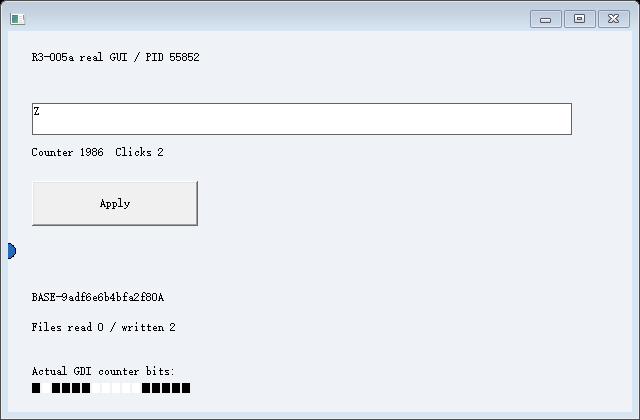
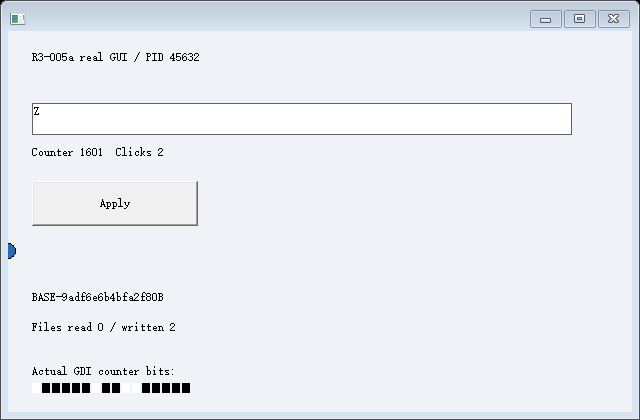
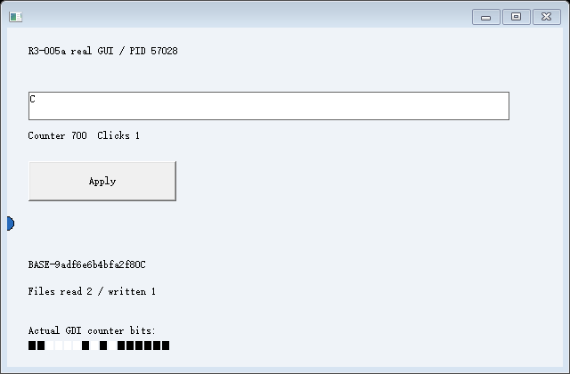

# R4-003-001：受限 A/B/C 成果闭环整合通过

2026-10-25，基于 `d12b7c24c05b97eca38d91ed3cd7fe1320486c4f` 实际构建并运行。Windows 11 x64（NT 10.0.26200）、普通权限；MSVC 19.44.35229.0、Windows SDK 10.0.18362.0、C++20 /MT，fixture /Od /Ob0，/GS、CFG、CETCOMPAT 保留。实际读取各目标 CET/CFG 策略；没有更改系统保护或使用虚拟机/驱动。

最终构建 ID 为 `47721791d47502277bb2b150ae422de706164a965ab4e49f1b46b252d862adc9`。完整源码及实际二进制 SHA256 见 [identity.json](identity.json)，工具链见 [build.json](build.json)、[build.log](build.log)、[loadconfig.txt](loadconfig.txt)。此报告仅覆盖本实验声明的资源；不表示通用应用恢复、可靠性门禁关闭或项目完成。

## 整合同一次运行中的状态与成果

[positive-1/controller.jsonl](positive-1/controller.jsonl) 记录了一份随机 S0：原生 EDIT 为 `BASE-9adf6e6b4bfa2f80`，选择 0..21、modified=1、canUndo=0。源初始化和前半段计算由调试器独立计数；保存后源受管文本继续变化，确认源退出才开始派生。

| View | PID | 恢复来源及实际行为 |
| --- | --- | --- |
| A | 48092 | 从 S0 恢复，原生 EDIT 一次替换为 A，真实 BUTTON 生成工作文件及 A-v1，然后保存 SA |
| B | 40636 | 从 S0 恢复，一次替换为 B，生成工作文件及 B-v1，然后保存 SB |
| RA | 55852 | 原 A 退出后从 SA 恢复原始执行状态、原生 Undo 和新的私有工作文件 |
| RB | 45632 | 原 B 退出后从 SB 恢复，独立继续执行及写自己的文件 |
| C | 57028 | 从原 S0 恢复，初始 EDIT/Undo/内存不含 A/B 的后续修改，初始工作区为空 |

运行时没有提交文档正文。应用在原生 BN_CLICKED 中使用 CreateFileW、WriteFile、FlushFileBuffers、CloseHandle；随后运行时依据实际完成回执、关闭计数和文件字节哈希发布固定 A-v1/B-v1。BUTTON 保存及恢复焦点不改变 A/B 的文本、选择、修改标志或已观察的一次 Undo。

SA/SB 捕获当时真实的受管内存、普通栈、CONTEXT、三个计算局部量、R10、返回关系、原生控件/Undo 图，以及已完成并关闭的工作文件版本。原 A/B 的自有进程句柄确认终止后才创建 RA/RB。每个载体从相同原 CALL 位置建立自己的合法 CET 链，再恢复原始字节，实际完成 leaf/middle/outer 的正常 RET；初始化与业务前缀没有重放。普通/影子返回槽、目标 CET_U/SSP 和独立原始计算核对均有记录，没有写源 SSP 或改 RET。

每个 View 发布前，不仅验证已续接和实际 GDI，还让目标 GUI 线程真正处理受管鼠标移动/屏障，读回未变化的原生控件状态；`input-ready` 回执和 input_processed 必须先于 view_published。不是仅以模块安装成功推断输入可用。

## 文件与 Snapshot 的一致性

`files.hpp` 是新增的必要整合层，只管理本应用指定工作区中的一个已关闭普通 `document.txt`。源输入完成并关闭、GUI 冻结且仍能响应资源查询后，运行时核对目标文件回执完成、liveHandles=0、写入/刷新/关闭一致，并以真实独占打开验证必要文件没有未关闭的读写句柄；文件内容须与目标应用完成回执的 SHA256 一致。

Snapshot 记录文件内容、逻辑名称、来源 View/PID/Action、长度、SHA256、原卷号和原文件对象身份。新工作区用 CREATE_NEW 写入、刷新、关闭，再从真实文件读回校验，通过后才重命名发布内部目录；GUI/CET 后续失败会清理本次私有目录，不发布 View。没有直接复用旧 A/B 工作目录，也没有扫描内存替换文件 HANDLE。

S0、SA、SB 各自的原始数据页、完整/活跃栈、CPU、资源/Undo、元数据、返回链、cookie ABI、程序身份及文件内容/清单均保留。指纹将文件清单和内容一起计算；脚本从这些原始文件重新计算 SHA256、receipt 和显式 HWND 差异，不只读取控制器的布尔结论。目标的七个 HWND 引用独立重关联，固定 Snapshot 字节没有变化。

RA/RB 的私有文件与原 A/B、Artifact 的原生文件对象独立。C 实际读取 A-v1/B-v1 的两个私有副本，追加自己的修改并生成结果。C 写入后 RA/RB 文件仍与各自 Snapshot 版本一致；RA/RB 后续通过 BUTTON 重写自己的工作文件后，旧 A/B 文件、Artifact 和其他分支文件不变。

本轮文件只验证受控应用生成的小文件内容版本及已声明归属。不覆盖打开句柄/位置、锁、映射、异步 I/O、ACL/ADS/完整元数据或任意文件系统沙箱。原始材料是实验格式，不承诺独立加载器、长期兼容或跨崩溃持久性。

## Action、真实文件与后续交互

[Action 账本](positive-1/actions.jsonl) 的 submitted、accepted、delivered、effect_confirmed/failed 分开记录。文件完成必须由目标 GUI 线程确认实际文件操作，不能仅把鼠标投递成功记为完成。Artifact 来源关联真正生成文件的 Action；Snapshot 发布关联文件版本和完整检查点。

可直接核对以下材料：

- [SA 文件版本](positive-1/SA-file.json)、[SA 原始文件字节](positive-1/SA-file.bin)、[SA 原生 Undo/资源图](positive-1/SA-resources.json)。
- [A-v1](positive-1/artifacts/A-v1/manifest.json) / [固定正文](positive-1/artifacts/A-v1/data.bin)，[B-v1](positive-1/artifacts/B-v1/manifest.json) / [固定正文](positive-1/artifacts/B-v1/data.bin)。
- [C 真实文件 API 回执](positive-1/C/file-effects.jsonl)、[私有 A](positive-1/workspace/C/imports/A.txt)、[私有 B](positive-1/workspace/C/imports/B.txt)、[应用处理结果](positive-1/workspace/C/processed.txt)。
- [RA 第一次 Undo](positive-1/RA/undo1-resources.json)、[第二次 Undo](positive-1/RA/undo2-resources.json)、[继续输入](positive-1/RA/continued-input-resources.json)。

第一次真实 EM_UNDO 恢复随机原文和全选，第二次反转上次 Undo，随后输入 Z 正常替换。RA/RB 重新保存自己的私有文件；C 在处理文件后用正常 Home/Shift+End 全选，再执行一次字符替换。没有扩大 Undo 观察器的范围，也没有用 EM_SETSEL 业务补写来制造输入效果。

下面是同一正例中的目标实际 GDI 图像：

本体共 218 张真实 Frame。238 个显式创建的进程实例全部确认退出、80 个 Desktop 全部确认关闭，按实例/时序处理 PID 复用。所有 Frame 以目标绘制时间、计数像素及来源路径核对；正例另比较终态保存与恢复后 EDIT 内部像素（排除闪烁 caret 列）。没有复制旧截图或按状态拼画面。宿主人工交互仍未执行，既有宿主采样限制没有升级为通过。

## 正反矩阵

七个场景各两轮，共 14 次新集成运行。正式脚本返回成功，2,519 项顶层证据检查全部通过，14 个控制器共 1,462 项断言符合预期；计数是证据核对数，不是不同能力的数量。只有 positive 的两次记为 `declaredR4IntegrationPassed=true`；其余十二次必须明确拒绝且保护已有分支和固定版本。详细检查及回归汇总见 [summary.json](summary.json)。

| 场景 | 实际拒绝及保护结果 |
| --- | --- |
| positive | S0 → A/B → Artifact + SA/SB → 原 A/B 退出 → RA/RB 与 C → C 私有处理 → 三者继续输入/绘制 |
| undo-unsupported | 第二次真实字符编辑后，`undo.unsupported_or_multiple_edits / 50` 拒绝 SA；不清空 Undo；A 继续运行，B 的 SB 可恢复，C 仍正常使用固定成果 |
| file-open | 测试侧持有真实 GENERIC_WRITE 句柄，`CreateFileW.snapshot_exclusive_closed_file / 32` 拒绝 SA；关闭该句柄后没有重试本次快照，其他分支/成果保留 |
| file-version | 故意破坏 RB 的恢复 staging 文件，实际读回不匹配，`restore.private_file_version / 23`；临时文件清理，RB 不发布，RA/C 继续 |
| file-write | 用真实只读句柄触发 `WriteFile.private_workspace / 5`，回收未发布副本；不是 CreateProcessW 的历史错误 5 |
| branch-failure | RB 进入错误的原 CALL 位置，`restore.call_chain_mismatch / 13`；已重建的私有工作区也回收，RA/C 不回滚 |
| artifact-hash | 只破坏导入 staging 副本，`artifact.import_hash / 23`，批次回滚、C 状态不变；固定 Artifact 未被改写。随后正常导入是单独的新 Action，原失败仍为 failed |

file-open 只证明真实独占条件的拒绝，不宣称已经枚举任意进程的所有隐藏文件句柄。RB 恢复失败后没有重试同一分支；失败被检测不计为对应能力成功。

## 历史证据与可靠性边界

旧回归全部实际重跑并通过，两个分层链各自保留完整证据：

| 链路 | 本体 | 嵌套回归 |
| --- | --- | --- |
| [R4-001](r4-001-regression/summary.json) | 8 次、2,860 项检查 | [c001](r4-001-regression/c001-regression/summary.json) 6 次/670 项 → [b001](r4-001-regression/c001-regression/b001-regression/summary.json) 18 次/280 项 → [CET-002](r4-001-regression/c001-regression/b001-regression/cet002-regression/summary.json) 14 次/285 项 |
| [R4-002a](r4-002a-regression/summary.json) | 20 次集成 + 2 次最小原生对照、1,674 项检查 | [c001](r4-002a-regression/c001-regression/summary.json) 6 次/670 项 → [b001](r4-002a-regression/c001-regression/b001-regression/summary.json) 18 次/280 项 → [CET-002](r4-002a-regression/c001-regression/b001-regression/cet002-regression/summary.json) 14 次/285 项 |

未修改旧实现或改写历史失败。R1/R2、独立键鼠完整矩阵本轮没有重跑，不称为本次复验。

GATE-002 管理员有界 ETW 已在上一轮完成，本轮没有增加任何创建压力循环或 ETW。原生 CreateProcessW 偶发拒绝的根因仍未确认，`gateClosed=false`。本体/功能回归结果和可靠性、产品可发布性分别判定。

开发期首次 C 输入在 BUTTON 操作后因光标已到行尾而发生追加，原断言准确失败；改为正常键盘全选后再输入，不降低断言。另一次发布前探针的有符号比较导致编译拒绝，误启动旧二进制的一轮已停止并标记无效、保存在本地 out/，没有计入正式证据；最终重新成功构建并执行整个矩阵。所有最终源码身份以 identity.json 为准。

结论只允许表述为：本实验的单次 EDIT Undo、已知执行结构、受管关闭普通文件和固定成果协议范围内，R4 端到端整合得到实证。连续 Undo、IME/RichEdit、任意资源/应用兼容、多线程、长期持久化及整体项目完成均未得到证明。
