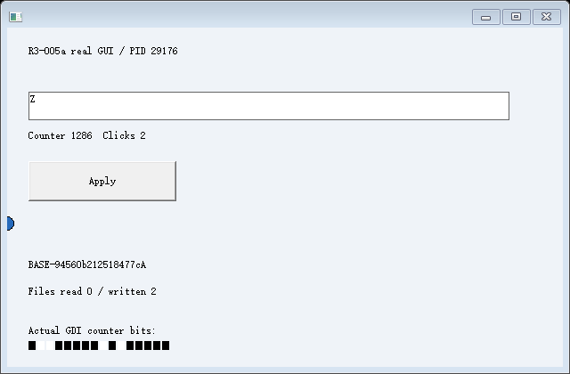
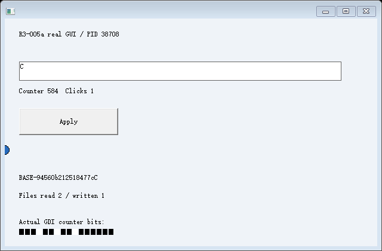

# R5-001a：独立管理器管理一个协作应用，受限通过

2026-10-25 实际构建和运行，基线提交 `3945eef4d5449ad39f6e891c6152add0d09797d7`。Windows 11 x64（NT 10.0.26200）、非管理员；MSVC 19.44.35229.0、Windows SDK 10.0.18362.0、C++20 /MT、fixture /Od /Ob0，CET、/GS、CFG 保留。构建 ID `ab493843cf05fda87c1670f786d01524792d1626f29eeeea2339ce1ab1e2bf1b`。

正式 20 次新场景、**3,710 项证据检查全部通过**，新控制器/内核合计 2,146 项断言符合预期。只有两个 positive 是完整受限链路成功；十八个负向场景是准确拒绝，不计为成功恢复。见 [summary.json](summary.json)、[源码与二进制身份](identity.json)、[构建](build.json) 和 [真实输出](build.log)。旧 R4-003 及其完整嵌套回归均实际通过。

只声明独立管理器能管理一个显式协作的受管应用。没有验证第二个应用、未改造程序、长期格式或跨管理器重启；原生创建可靠性门禁继续为 false。

## 三个独立 EXE 与模块边界

管理器、应用和辅助进程分别编译、链接。manager.exe 没有 fixture 角色，fixture.exe 没有 manager/helper 角色。应用初始化、计算、文档生成/处理和 traps.asm 只链接到 fixture.exe；manager 使用 kernel.lib 和实验客户端，输入/取图桥只链接到 helper.exe。

见 [编译/链接分组](link-boundaries.json) 和 [符号边界审计](boundary-audit.json)。manager.map 中 `R305ManagedEntry`、`application_files`、leaf/middle/outer 应用实现符号均为 0。内核源码不包含 Work、seed、业务 receipt 算法或 fixture 客户端契约，也不调用本进程 RtlLookupFunctionEntry。

manager.exe 仍链接本实验的 `scenario` 验收客户端，它知道 fixture 的 Work/邮箱 schema 和计算预期；这些不是恢复内核的知识，也不是应用实现。业务 oracle 在客户端，原始捕获/恢复、引用重关联、文件版本及 CET 检查在运行时模块。没有将测试客户端冒充通用管理服务。

应用显式声明运行时 ABI 版本、大小、架构、区域、必要资源种类、停点和引用；测试客户端另检查应用契约版本、Work 和邮箱大小。固定地址只存在于应用客户端契约，内核通过目标声明获得区域。窗口根类、控制 ID 和文件名按声明/实际资源核对；不扫描内存猜测对象。

## 目标 PE unwind，管理器与目标映像不同

[正例原始日志](positive-1/controller.jsonl) 的实际二进制身份：

- manager SHA256：`852879f096a3ce9f403b0b92f48128f56697e5a234b61c6a90f77c778622c3e4`。
- fixture SHA256：`4ce0f892aafd9f062e4c5677c9fd50e8d75fdddd545340fd8fc9e25d89f30024`。
- 首次检查点目标基址：140699010924544；管理器基址：140702307713024，实际不同。
- 目标异常目录共有 3,597 个函数项。新矩阵保存 226 条目标 PE unwind 观测，均没有使用管理器函数表，也没有执行诊断映像。

运行时从目标进程读取 PE 头和可读映像页，核对目标磁盘文件身份、加载头、异常目录和实际函数表字节。随后将目标映像和捕获栈放入**相同虚拟地址的本地诊断副本**，映像页改为只读、不可执行。函数表查找由目标 `.pdata` 显式完成，再调用 RtlVirtualUnwind；没有 LoadLibrary 执行 fixture，没有换用管理器自身表，没有注册伪造的系统函数表。

这是当前固定布局实验的有界方案；如管理器对应地址已占用、unwind 版本不在支持范围或元数据无法核验，直接失败，不移动指针后继续。保存的 target-image.bin 是诊断材料，不是把整个应用映像可变全局状态恢复到目标。

每个载体通过正常 CALL 先建立自己的受保护返回链，普通返回地址和真实 CET_U/SSP 下的影子返回地址逐层相等后，才恢复原始内存、栈及上下文。源 SSP 不写入目标，RET 不改成跳转。真正 RET 后到达续接停点，客户端再独立核对原始局部量、R10 与计算结果，没有重放业务初始化/前缀。

公开接口依据：[RtlVirtualUnwind](https://learn.microsoft.com/en-us/windows/win32/api/winnt/nf-winnt-rtlvirtualunwind)、[x64 exception handling](https://learn.microsoft.com/en-us/cpp/build/exception-handling-x64)。接口依据与本次独立映像实测分开；没有从文档推导任意进程恢复已成立。

## 同一次运行中的原 R4 链路

源应用生成随机 `BASE-94560b212518477c`、未保存内存和实际执行状态，保存 S0 后继续变化并确认退出。A/B 从 S0 真正恢复，原生 EDIT 各全选替换一次，再经受管鼠标点击原生 BUTTON，由应用正常 Win32 文件操作生成成果，发布 A-v1/B-v1。

SA/SB 保存各自原始区域、普通栈、CPU、合法返回关系、原生 Undo、七个 HWND 引用和已关闭工作文件版本。原 A PID 46956、B PID 56628 确认退出后，RA PID 29176、RB PID 52340 分别恢复终态；C PID 38708 从原 S0 恢复。它们属于不同 Desktop、GUI 线程、输入通道、CET 链和私有文件对象。

RA/RB 原生 Undo、再次 Undo、继续输入和文件重写保持独立。C 实际读取两个固定成果的私有副本，生成处理结果，再正常输入和绘制。原工作文件、S0/SA/SB 和 Artifact 的固定字节/指纹保持。私有文件、Action 完成回执、业务计算、资源重建和真实 GDI 分项核对，不能把模块加载或消息投递等同于业务成功。

可核对 [SA 资源/Undo](positive-1/SA-resources.json)、[SA 文件版本](positive-1/SA-file.json)、[Action](positive-1/actions.jsonl)、[A-v1](positive-1/artifacts/A-v1/manifest.json)、[C 原生读写](positive-1/C/file-effects.jsonl)、[C 处理结果](positive-1/workspace/C/processed.txt)。

308 张真实 GDI Frame 用目标绘制日志、计数像素和来源核对；正例恢复后的 EDIT 区域像素与保存终态一致，排除 caret 列后的比较比例为 1.0。332 个显式创建的进程实例、116 个 Desktop 全部确认清理，按实例时序处理 PID 复用。

## 拒绝矩阵

十个场景各两轮：positive，以及原 R4 的 undo-unsupported、file-open、file-version、file-write、branch-failure、artifact-hash，另加：

| 新兼容性场景 | 实际结果 |
| --- | --- |
| wrong-image | 自有应用副本的实际 PE 时间戳字节改变，哈希核验得到 `image.file_identity_mismatch / 1306`，创建目标前拒绝 |
| abi-mismatch | 目标进程声明不匹配的运行时 ABI，`abi.header_mismatch / 1306`，目标清理且不发布 |
| unknown-resource | 应用创建额外子窗口并声明未知必要资源种类，`abi.unknown_required_resource / 50`，拒绝发布 |

RB 失败后 RA 保持原状态并继续运行，C 仍从 S0 正常恢复和处理成果；没有重试同一恢复，没有共享原可变文件或回退同 EXE。其他负例仍分别得到真实 Undo 拒绝、sharing violation、版本 CRC、原生 WriteFile 拒绝、CET 调用关系不匹配及导入哈希拒绝。预期失败不是对应能力成功。

## 回归、交付及限制

[旧 R4-003](r4-003-001-regression/summary.json) 的 14 次/2,519 项完整通过；其中 R4-001 8 次/2,860 项、R4-002a 20 次加 2 次最小对照/1,674 项，以及两条链各自的 c001 6 次/670 项、b001 18 次/280 项、CET-002 14 次/285 项均实际通过。旧源码/历史结果未改；R1/R2 与独立键鼠完整矩阵没有额外重跑，不称本次复验。

[Windows x64 构建包](r5-001a-windows-x64.zip) 包含 manager.exe、fixture.exe、helper.exe、runtime304.dll 和两份实验静态库。解压后保持同目录，按 RUN.txt 使用新输出目录运行。包内文件与实际构建输出逐字节比较，见 [包清单/哈希](binary-package.json)。不是稳定 SDK 或生产发行版。

物理拆分首次暴露 GetCursorPos 原先由 bridge 编入同 EXE 的隐式导入依赖，输入安装真实返回 127 并拒绝；fixture 增加只读查询后，沿用原模块通过，没有伪造返回。早期编译/链接诊断也保留在本地 out/，包括旧单翻译单元 native.hpp 的 ODR 冲突；改用一个 native.cpp 实现和声明头，未修改共享工具或忽略链接错误。

范围仍是单 GUI 线程、受限原生控件/Undo、关闭普通文件、固定虚拟地址和编译期协作。镜像/栈地址冲突、未知 unwind 元数据不支持；完整启动栈、TLS/堆、任意优化代码、活跃输入/I/O、任意应用和管理器重启恢复均未验证。manager 的实验客户端仍专用于此 fixture，第二应用适配未执行。

GATE-002 历史 CreateProcessW / 5 根因未知，本轮没有新 ETW 或压力循环，gateClosed=false。人工宿主交互仍未执行，不升级既有结论。唯一新增能力声明是：独立原生管理器与另一个独立编译、显式协作的应用，能够完成本实验资源范围内的原 R4 链路。

原始 Git 材料另核对 152 份本体 Snapshot 文件正文、目标诊断映像及 Artifact blob，全部与捕获工作区字节相同，见 [Git 字节核对](git-payload-verification.json)；实验私有 `.gitattributes` 禁止结果目录换行转换。
