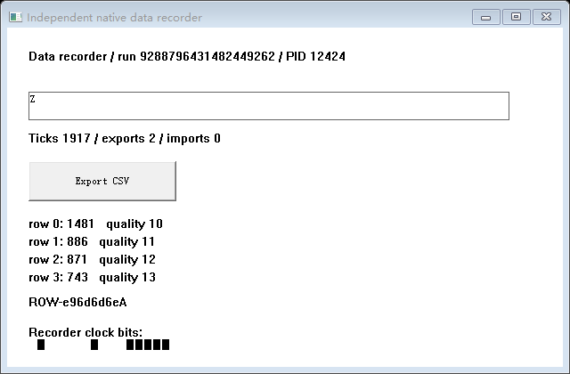
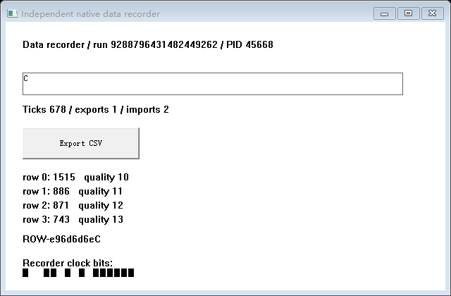

# R5-002：有限可变深度协作式执行恢复

日期：2026-10-26（UTC+08）。源码基线：`aa57ab7ccee4bc7164201db6030002d45c016514`，新代码源身份见各 application identity、kernel-identity 和运行包。正式整套脚本通过，终端标记 `R5_002_DECLARED_EXECUTION_PASSED`。

## 本轮结论

旧 ABI v1 三帧/五返回关系兼容与真实 ABI v2 四帧/六返回关系恢复分别通过受限验收。同一 manager 二进制、同一新版 kernel.lib 分别管理两款未重编译的旧应用与真实四帧变体。四帧从源 S0 保存后确认源退出，在新 PID 合法 CALL 建立 CET 链，恢复原始内存/栈/R10，再实际完成 sample、fold、emit、record 的正常 RET；业务初始化和前缀没有在恢复目标重放。

| 应用 | Runtime ABI | 协作帧/返回关系 | 主场景 | 证据检查 | 完整正例/明确拒绝 |
| --- | --- | --- | --- | --- | --- |
| 原 fixture.exe，原件未重编译 | v1 | 3/5 | 20 | 3,934 | 2/18 |
| 原 second.exe，以 legacy.exe 保留原件 | v1 | 3/5 | 20 | 4,030 | 2/18 |
| 新四帧 second.exe | v2 | 4/6 | 30 | 6,160 | 2/28 |

主矩阵共 70 次、14,124 项证据检查、8,194 项控制器/内核断言；1,164 个创建进程实例、408 个 Desktop 清理核对，1,074 张真实 GDI Frame 核对。另有安全点 3 次/10 项、错误客户端启动前拒绝及 20 项套件核验。共 14,154 项当前范围证据核验；不把检查项数量称为能力数量。详见 [statistics.json](statistics.json)、[summary.json](summary.json) 及各 `*-summary.json`。

## 真实四帧与 ABI 核验

```text
application → record → emit → fold → sample → CheckpointTrap
                         保存 S0，源继续变化后退出
新 PID 跳过业务前缀，通过同一 CALL 位置建立自身合法链
                         原始字节/CPU 恢复
CheckpointTrap RET → sample RET → fold RET → emit RET → record RET
```

v1 Metadata 的 5,120 字节保持原定义，两个旧 EXE 的 SHA256 与上轮原件一致。v2 使用同一个完整前缀加 216 字节 ExecutionLayout，头部声明总长 5,336；描述包含版本、长度、有限帧数、返回数、函数入口、局部量、业务停点及调用者边界。仅接受 3/4 帧，编码容量 8 不代表支持八帧或任意深度。

内核使用目标 PE 的只读映像及 RtlVirtualUnwind，按内到外的实际帧顺序核对函数、局部量所处栈帧、外部调用者边界和全部普通/影子返回位置。实际 RIP 与声明入口分开记录；恢复还要求源/目标返回关系、RSP、局部量地址和结构相同。没有写源 SSP 或影子页，没有改 RET 为跳转。

第四帧有独立局部量、业务停点及计算依赖；C++ `/Od /Ob0`，不是只改声明。测试客户端从原始栈和 CPU 字节独立计算结果；遗漏第四局部量和遗漏 R10 均能完成真实 RET，但计算错误，恢复分支拒绝发布。真实四帧却声明三帧/五返回时，由实际 unwind 的调用者边界拒绝；缺帧、声明错误函数、合法却错误的 CALL 返回位置及未知 ABI 各有独立拒绝证据。

每款应用分别完成 S0/A/B、原生 EDIT 单次 Undo、Artifact、含私有关闭文件的 SA/SB、源 A/B 退出后的 RA/RB，以及 C 从原 S0 私有处理固定成果。Snapshot 指纹包含新增执行描述与完整返回向量，七个显式 HWND 引用仍分别重关联；C 和各分支后续写入不污染原版本。

## 构建与环境

- Windows NT 10.0.26200.0 / Windows 11 x64，普通权限；PowerShell 7.6.5。
- MSVC 19.44.35229.0，工具目录 14.44.35207，SDK 10.0.18362.0，C++20，静态 `/MT`。
- `/GS /guard:cf /CETCOMPAT /DYNAMICBASE /NXCOMPAT` 保持；日志实际核对 CET_U 和 CFG，不修改系统策略。
- manager SHA256：`d04ff2cdf5d04dda180ca3f9225b6c9e9e2b6cb53341ac4faa1103fd553ce749`。
- 新 kernel.lib SHA256：`f23a31c605c8f4b859ccb0f5b36a35f9124d24f9902cf7c7571694bba009dde9`；三组应用身份及链接清单核对同一内核。
- target.lib、helper.exe、runtime304.dll 与旧 EXE 原件未变，见 reuse.json。内核不含 State/Work、业务公式或文件格式；业务 oracle 留在显式实验客户端。

## 历史红项与安全点补强

[首轮原始失败](../20261026-r5002/report.md) 的 omit-register-2 在源 S0 前拒绝 ERROR_BUSY(170)，没有到达寄存器负例。控制器错误为 validate/13；原记录缺少具体队列消息，历史触发消息仍未知。首轮总 summary 保持 false。

确定性 queued-paint 对照证明同类拒绝：冻结/资源就绪/无捕获时，所属窗口迟到的 WM_PAINT 使原检查拒绝。修正仅在 1 秒期限内正常 Dispatch 所属窗口绘制，再重新要求队列为空、输入关闭、资源就绪且无捕获/绘制；不重启进程或重试 Snapshot。未知消息、两次 Peek 间出现的 WM_QUIT 都实际拒绝。PM_REMOVE 后再次核对消息/HWND，不能把已取出的其他消息误当作绘制。对照原件见 `checkpoint-guard-raw.tar.xz`；不能据此认定历史消息类型已查明。

[第二轮 summary](../20261026-r5002-quiescent/report.md) 也保持 false：70 个原生场景都完成，但新增证据检查误要求采集前拒绝 SA 的 A 提供后续检查点记录。现按真实 raw_capture 与 guard 一一对应；缺少实际捕获的 guard 或队列非空仍失败，反例见 [只读审计验证](../queue-evidence-counterexamples.json)。原生二进制没有为该判据修改；最终完整矩阵重新运行，没有直接翻改旧红项。

## 回归与证据交付

本次完整重跑旧 R5-001b：fixture 20 次/3,766 项、recorder 22 次/4,248 项、套件 14 项，全部通过。其后实际运行 R5-001a 20 次/3,710 项、R4-003 14 次/2,519 项、R4-001 8 次/2,860 项、R4-002a 20 次/1,674 项，以及两条分支各自完整 c001(6/670)、b001(18/280)、CET-002(14/285) 回归，均通过。逐层路径和状态见 [regressions.json](regressions.json)、完整原件 `r5-001b-regression-raw.tar.xz`；不是引用旧报告替代本次执行。旧实验代码没有改动。

- [原始四帧执行记录节选](four-frame-execution.jsonl) 为真实 controller.jsonl 的原行筛选，来源/哈希见 [selected-evidence.json](selected-evidence.json)。
- 每组 `*-raw.tar.xz` 含完整 CPU、栈、Metadata/ExecutionLayout、资源、文件、Action/Artifact、原生输入/Undo 和图像；对应 `*-archive-manifest.json` 对解压后的每项长度/字节 SHA256 核对。用 Windows `tar.exe -xf <archive> -C <新的目录>` 可重建相对路径。
- [已测试原生运行包](r5-002-windows-x64.zip) 与 [包校验](binary-package.json) 提供同一 manager、三个客户端、两个旧 EXE、新四帧 EXE、helper/DLL 和库/链接证据，源文件哈希与测试身份匹配。
- 前两轮 summary、主要失败原件及当时构建身份单独保留；其余先前原始目录仍在本地，没有覆盖、删除或改记成功。





## 严格范围

仅同机/同构建/固定地址、编译期协作、单 GUI 线程、三或四个已声明 C++ 帧、既有 top/EDIT/BUTTON/七个 HWND、单次 ASCII 全选替换 Undo、已关闭同步普通私有工作文件。不是任意深度、未改造应用、多线程、任意控件/输入、稳定 SDK 或跨 manager 重启持久恢复。

人工宿主交互未执行；新会话 key-up/release 不是持有按键/拖拽现场恢复。R1/R2 及独立键鼠矩阵未额外重跑。历史 CreateProcessW/5 根因仍未知，gateClosed=false；本轮不追加创建压力或 ETW，不因 ABI 实验通过关闭可靠性门禁。只声明上述有限执行/资源范围通过，不宣布项目整体完成。
